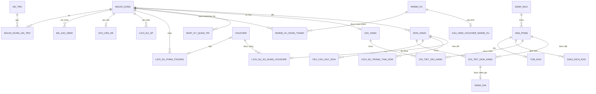
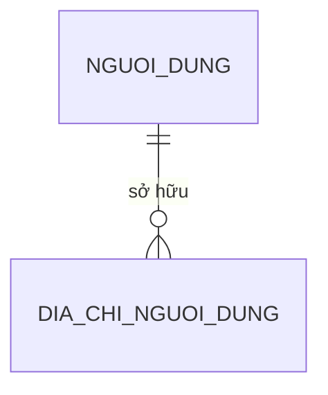
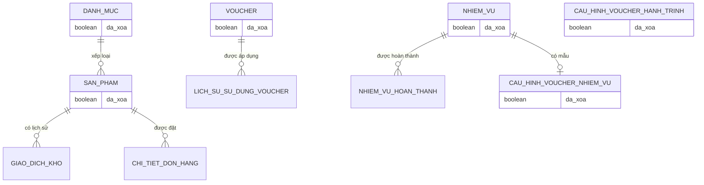

# Đặc tả dữ liệu tài khoản — GALAXORA

> Bước 3.3. Người dùng đã nghiệm thu đặc tả ngày 12/11/2026.

## 1. Phạm vi và quy ước

Đặc tả này phục vụ đăng ký, phân quyền, khóa tài khoản và đổi mật khẩu theo [plan.md](../plan.md) mục 4, [yêu cầu tài khoản](requirements.md#41-tài-khoản-và-hồ-sơ) và [thiết kế xác thực](architecture.md). Hồ sơ mở rộng, địa chỉ nhận hàng, thông báo và quy trình đổi thông tin liên hệ sẽ được đặc tả ở các bước liên quan.

- Dùng MySQL 8, InnoDB và `utf8mb4` cho dữ liệu văn bản tiếng Việt.
- Lưu các mốc thời gian theo UTC bằng `DATETIME(6)`. Backend chịu trách nhiệm chuyển đổi trước khi ghi và khi hiển thị. Giữ tên `created_at`, `updated_at` theo mục 14.1 của plan.
- Các khóa chính số tự tăng dùng `BIGINT`. Khóa ngoại dùng cùng kiểu với khóa được tham chiếu. Các khóa ngoại trong thiết kế này dùng `ON DELETE RESTRICT`. Trạng thái khóa tài khoản được lưu trên bản ghi người dùng.

## 2. Bảng và cột

### `nguoi_dung`

| Cột | Kiểu | Bắt buộc | Ràng buộc và ý nghĩa |
|---|---|---|---|
| `id` | `BIGINT` | Có | PK, tự tăng. |
| `ho_ten` | `VARCHAR(255)` | Có | Họ tên dùng để hiển thị. |
| `email` | `VARCHAR(254)` | Có | Địa chỉ dùng làm định danh đăng nhập. |
| `email_chuan_hoa` | `VARCHAR(254)` | Có | UNIQUE, collation `utf8mb4_0900_bin`. Backend chuyển khóa tra cứu sang chữ thường bằng `Locale.ROOT`. |
| `so_dien_thoai` | `VARCHAR(32)` ASCII | Có | UNIQUE, lưu theo E.164. Dùng chuỗi để giữ dấu cộng. |
| `mat_khau_bam` | `CHAR(60)` ASCII | Có | Chuỗi BCrypt. |
| `xac_minh_email_luc` | `DATETIME(6)` | Không | Mốc xác minh lịch sử. Ứng dụng hiện không đọc hoặc ghi cột này. |
| `khoa_luc` | `DATETIME(6)` | Không | Có giá trị khi Admin khóa. Trả về `NULL` khi mở khóa. |
| `created_at` | `DATETIME(6)` | Có | Thời điểm tạo tài khoản. |
| `updated_at` | `DATETIME(6)` | Có | Thời điểm thay đổi gần nhất. |

Đăng nhập tra cứu bằng khóa email chuẩn hóa hoặc số điện thoại chuẩn hóa. Backend tạo phiên cho tài khoản đang mở khóa sau khi kiểm tra đúng mật khẩu. UNIQUE ở database bảo đảm hai yêu cầu đồng thời không thể đăng ký trùng thông tin liên hệ.

### `vai_tro`

| Cột | Kiểu | Bắt buộc | Ràng buộc và ý nghĩa |
|---|---|---|---|
| `id` | `BIGINT` | Có | PK, tự tăng. |
| `ma` | `VARCHAR(16)` ASCII | Có | UNIQUE. CHECK so sánh đúng từng byte với `USER` và `ADMIN` theo phạm vi hiện tại. |

### `nguoi_dung_vai_tro`

| Cột | Kiểu | Bắt buộc | Ràng buộc và ý nghĩa |
|---|---|---|---|
| `nguoi_dung_id` | `BIGINT` | Có | FK tới `nguoi_dung.id`, thành phần đầu của PK. |
| `vai_tro_id` | `BIGINT` | Có | FK tới `vai_tro.id`, thành phần thứ hai của PK. Có index riêng để tra cứu theo vai trò. |

`nguoi_dung` và `vai_tro` có quan hệ nhiều-nhiều qua bảng liên kết. PK ghép ngăn gán trùng vai trò cho cùng tài khoản. Backend gán `USER` trong cùng giao dịch tạo tài khoản và bỏ qua dữ liệu vai trò do khách gửi. Mã vai trò là dữ liệu tham chiếu của hệ thống.

### `ma_xac_minh`

Bảng lịch sử từ Flyway V1, được giữ trong lược đồ. Ứng dụng hiện không phát hành hoặc tiêu thụ mã trong bảng này.

| Cột | Kiểu | Bắt buộc | Ràng buộc và ý nghĩa |
|---|---|---|---|
| `nguoi_dung_id` | `BIGINT` | Có | FK tới `nguoi_dung.id`, thành phần đầu của PK. |
| `muc_dich` | `VARCHAR(24)` ASCII | Có | Thành phần thứ hai của PK. CHECK so sánh đúng từng byte với `XAC_MINH_EMAIL` và `DAT_LAI_MAT_KHAU`. |
| `gia_tri_bam` | `BINARY(32)` | Có | Giá trị dùng để đối chiếu mã hoặc token. UNIQUE trên cặp `(muc_dich, gia_tri_bam)` để tra cứu token đặt lại mật khẩu. |
| `so_lan_sai` | `TINYINT UNSIGNED` | Có | Mặc định 0, CHECK từ 0 đến 5 cho mã xác minh. Với token đặt lại, cột này luôn bằng 0. |
| `phat_hanh_luc` | `DATETIME(6)` | Có | Mốc phát hành để tính hạn và khoảng chờ gửi lại mã. |
| `het_han_luc` | `DATETIME(6)` | Có | CHECK lớn hơn `phat_hanh_luc`. |
| `da_dung_luc` | `DATETIME(6)` | Không | `NULL` khi chưa dùng. Khi có giá trị, CHECK bảo đảm từ mốc phát hành đến trước mốc hết hạn. |

## 3. Giao dịch và quy tắc xác thực

- Khi đổi mật khẩu, backend khóa bản ghi của tài khoản và xác minh mật khẩu hiện tại trong giao dịch trước khi cập nhật BCrypt. Phiên dùng mật khẩu cũ mất hiệu lực.

## 4. Migration và mục còn mở

- [Migration V1](../database/migrations/V1__khoi_tao_tai_khoan.sql) tạo bốn bảng và khởi tạo mã vai trò `USER`, `ADMIN`. Chạy Flyway qua Spring Boot từ thư mục `backend/`.
- Quy tắc chuẩn hóa đã áp dụng cho đăng ký và đăng nhập. Phần cập nhật email/số điện thoại (TK-06) cần dùng cùng quy tắc khi triển khai.
- Giới hạn đăng nhập được mô tả ở [đặc tả API](api-specification.md).
- ERD được vẽ sau khi hoàn thiện website theo quyết định đã ghi trong [plan.md](../plan.md).

## 5. Chạy kiểm thử tích hợp

Tạo một schema MySQL cục bộ, rỗng, có tên bắt đầu bằng `galaxora_test_`, cùng tài khoản chỉ có quyền trong schema đó. Đặt `GALAXORA_DB_TEST_URL` theo mẫu `jdbc:mysql://127.0.0.1:3306/galaxora_test_<ten>` và đặt `GALAXORA_DB_TEST_USER`, `GALAXORA_DB_TEST_PASSWORD` trong môi trường trước khi chạy `mvn test` từ thư mục `backend/`. Khi thiếu URL kiểm thử, Maven bỏ qua lớp tích hợp MySQL. Lớp này chạy migration và tạo bản ghi kiểm thử. Mỗi lần chạy cần schema rỗng.

## 6. Cửa hàng, kho và đơn hàng

Flyway áp dụng [V2](../database/migrations/V2__cua_hang_va_kho.sql) rồi [V3](../database/migrations/V3__don_hang.sql). Khóa định danh dùng `BIGINT`, tiền dùng `DECIMAL(15,2)` theo VND, thời điểm lưu theo UTC. Kết nối ứng dụng đặt múi giờ phiên MySQL về UTC.

| Bảng | Dữ liệu và ràng buộc |
|---|---|
| `danh_muc`, `san_pham` | Tên danh mục và SKU có ràng buộc duy nhất riêng. Sản phẩm thuộc một danh mục và có cờ hiển thị, cờ kinh doanh, hai giá và mô tả. |
| `hinh_anh_san_pham`, `mo_hinh_3d_san_pham` | Ảnh dùng URL HTTPS và mô tả. Mỗi sản phẩm có tối đa một tệp 3D tự chứa cùng định dạng, dung lượng, giấy phép, nguồn, tác giả, ghi công và trạng thái duyệt. |
| `yeu_thich` | PK ghép người dùng và sản phẩm. |
| `cau_hinh_ban_hang` | Một bản ghi, phí COD và ngưỡng kho có thể chưa được cấu hình. Flyway tạo bản ghi với hai giá trị `NULL`. |
| `ton_kho` | Một dòng cho mỗi sản phẩm. CHECK bảo đảm `0 <= dang_giu <= thuc_te`. Tồn khả dụng được tính khi đọc. |
| `phieu_nhap_kho`, `chi_tiet_phieu_nhap` | Người lập, lý do, khóa yêu cầu duy nhất và các dòng sản phẩm với số lượng dương. |
| `giao_dich_kho` | Biến động thực tế và đang giữ, số dư sau biến động, lý do, người thực hiện, phiếu hoặc đơn liên quan. Duy nhất theo khóa yêu cầu hoặc tổ hợp đơn, sản phẩm và loại biến động. |
| `gio_hang`, `chi_tiet_gio_hang` | Một giỏ cho mỗi người dùng. Mỗi sản phẩm có tối đa một dòng trong giỏ. |
| `don_hang`, `chi_tiet_don_hang` | Mã đơn, người đặt, bản chụp thông tin nhận hàng, SKU, tên, giá và số lượng. Trạng thái đơn và xác nhận thu COD là hai cột. Khóa yêu cầu duy nhất theo người đặt. |
| `lich_su_trang_thai_don`, `yeu_cau_huy_don` | Lịch sử trạng thái lưu người thực hiện, lý do và thời điểm. Yêu cầu hủy lưu người gửi, người xử lý, lý do và quyết định. Cột sinh `dang_cho` bảo đảm tối đa một yêu cầu đang chờ trên một đơn. |
| `voucher`, `lich_su_su_dung_voucher` | Mã duy nhất, loại và giá trị giảm, mốc thời gian, quota, chủ sở hữu tùy chọn và trạng thái. Mỗi đơn có tối đa một lần dùng. |
| `danh_gia`, `lich_su_danh_gia` | Khóa ghép đơn, sản phẩm, người dùng. FK tới dòng đơn. Mỗi lần sửa thực sự lưu điểm và nội dung bản trước. |

Checkout khóa người đặt và dòng voucher được sử dụng, tính lại tổng tiền, tạo đơn, ghi lịch sử và dọn giỏ trong cùng giao dịch. Admin xác nhận, giao thành công, giao thất bại hoặc duyệt hủy trong giao dịch khóa đơn và các dòng tồn kho theo thứ tự mã sản phẩm. Hủy không trả lượt voucher. Trạng thái `DANG_GIAO` chỉ bắt đầu sau khi xử lý yêu cầu hủy đang chờ.

## 7. Hồ sơ khám phá

| Bảng | Dữ liệu và ràng buộc |
|---|---|
| `lich_su_xp` | Khóa ngoại tài khoản, nguồn, mã nội dung, số XP có dấu khác 0 và thời điểm UTC. Khóa duy nhất theo tài khoản, nguồn và mã nội dung. |
| `lich_su_phan_thuong` | Khóa ghép tài khoản và mã phần thưởng. Loại huy hiệu hoặc voucher. Voucher tham chiếu một dòng voucher riêng và chỉ được ghi một lần. |

Migration V4 tạo hai bảng. Hồ sơ tính tổng XP từ lịch sử và cấp độ từ ngưỡng đã duyệt. Ghi nhận khám phá, cấp huy hiệu và cấp voucher khóa dòng tài khoản. Cấp voucher còn khóa cấu hình lượt cấp và tạo một voucher cá nhân theo cùng giao dịch.

## 8. Cấu hình và quản trị

| Bảng | Vai trò |
|---|---|
| `cau_hinh_voucher_hanh_trinh` | Một cấu hình gồm giá trị giảm, thời hạn, tổng lượt cấp và số đã cấp. |
| `noi_dung_kham_pha`, `noi_dung_nhiem_vu` | Nội dung hiển thị theo mã thiên thể, khu vực hoặc nhiệm vụ. |
| `su_kien_kham_pha` | Tiêu đề, mô tả, thời gian UTC và quyền hiển thị sự kiện. |
| `nhat_ky_quan_tri` | Mã Admin, mô tả thao tác, đường dẫn gắn với đối tượng và thời gian UTC. Bản ghi mới được lưu cùng giao dịch nghiệp vụ. |
| `doi_lien_he` | Một yêu cầu đang chờ mỗi tài khoản, mã HMAC, thời hạn, số lần sai và phiên bản tài khoản lúc phát hành. |

Sơ đồ thể hiện quan hệ chính đến Flyway V6. [Tệp ERD chỉnh sửa](galaxora-erd.drawio)
gồm trang tổng quát V1–V5 và trang bổ sung V6. [Bản xem V6](galaxora-erd-v6.svg).

## 9. Nhiệm vụ cấu hình được

| Bảng | Dữ liệu và ràng buộc |
|---|---|
| `nhiem_vu` | Mã tự tăng, tên, mô tả, loại và mã điều kiện, XP, tên huy hiệu tùy chọn, cờ voucher và kích hoạt. Có ít nhất một phần thưởng. |
| `nhiem_vu_hoan_thanh` | Khóa ghép tài khoản và nhiệm vụ, hai khóa ngoại tương ứng, thời điểm UTC. Một tài khoản có tối đa một lượt hoàn thành mỗi nhiệm vụ. |
| `cau_hinh_voucher_nhiem_vu` | Mỗi nhiệm vụ có tối đa một cấu hình. Lưu loại giảm, giá trị, giới hạn giảm/đơn, thời hạn UTC, tổng lượt, lượt đã cấp và trạng thái. |

Backend đối chiếu khám phá, chương và dấu hiệu ẩn với dữ liệu đã ghi
nhận. Giao dịch giữ khóa tài khoản khi ghi hoàn thành và thưởng. XP và
huy hiệu dùng mã `NV_{id}`, voucher dùng `VOUCHER_NV_{id}`. Khi đủ điều
kiện, cập nhật lượt cấp, tạo voucher một lần dùng cho tài khoản và ghi
lịch sử trong cùng giao dịch.

## 10. Sổ địa chỉ (Flyway V7)

| Cột của `dia_chi_nguoi_dung` | Kiểu và ràng buộc |
|---|---|
| `id` | BIGINT tự tăng, khóa chính |
| `nguoi_dung_id` | BIGINT, FK bắt buộc tới `nguoi_dung.id`. Index theo chủ sở hữu và ID |
| `nguoi_nhan` | VARCHAR(160), bắt buộc |
| `so_dien_thoai` | VARCHAR(16), bắt buộc |
| `dia_chi` | VARCHAR(500), bắt buộc |
| `created_at`, `updated_at` | DATETIME(6), bắt buộc. MySQL cập nhật thời điểm khi lưu thay đổi |

Đơn lưu thông tin người nhận, số điện thoại và địa chỉ riêng tại lúc đặt. Sửa hoặc xóa địa chỉ đã lưu không đổi nội dung đơn cũ.

## 11. Xóa trong Quản trị (Flyway V8)

V8 thêm `da_xoa BOOLEAN NOT NULL DEFAULT FALSE` vào sáu bảng dưới đây. Các khóa định danh, khóa ngoại và quy tắc giữ hàng tiếp tục dùng cấu trúc hiện hành. Trạng thái xóa ngừng hiển thị đối tượng ở danh sách sử dụng tương ứng và bảo toàn lịch sử đã ghi. Danh mục chưa từng chứa sản phẩm có thể xóa trực tiếp.

Seed 39 sản phẩm mẫu đi qua API quản trị. Số lượng nhập được ghi cùng phiếu và biến động kho. Ngưỡng vẫn là một giá trị tại `cau_hinh_ban_hang`.
