# Từ điển dữ liệu GALAXORA

[Về README chi tiết](../READMECHITIET.md#7-cơ-sở-dữ-liệu)

## 7.1. Phạm vi

Danh sách gồm các bảng nghiệp vụ tạo bởi Flyway V1–V6. `flyway_schema_history` do Flyway quản lý và được dùng để truy vết phiên bản migration. Kiểu, DEFAULT và các ràng buộc bên dưới lấy từ SQL. Cột thiếu `NOT NULL` có thể nhận NULL trừ khi thuộc khóa chính. Các tên thời điểm `created_at` và `updated_at` theo DDL. Phiên JDBC dùng UTC theo [application.yml](../backend/src/main/resources/application.yml).

| Bảng | Vai trò | Migration |
|---|---|---|
| `nguoi_dung` | Định danh, thông tin liên hệ, BCrypt và trạng thái tài khoản | [V1](../database/migrations/V1__khoi_tao_tai_khoan.sql) |
| `vai_tro` | Danh mục mã vai trò USER và ADMIN | [V1](../database/migrations/V1__khoi_tao_tai_khoan.sql) |
| `nguoi_dung_vai_tro` | Liên kết nhiều–nhiều giữa tài khoản và vai trò | [V1](../database/migrations/V1__khoi_tao_tai_khoan.sql) |
| `ma_xac_minh` | Bảng lịch sử cho mã xác minh và token đặt lại. Ứng dụng hiện không sử dụng. | [V1](../database/migrations/V1__khoi_tao_tai_khoan.sql) |
| `danh_muc` | Danh mục cửa hàng, tên và cờ hiển thị | [V2](../database/migrations/V2__cua_hang_va_kho.sql) |
| `san_pham` | SKU, thông tin hiển thị, giá và trạng thái bán | [V2](../database/migrations/V2__cua_hang_va_kho.sql) |
| `hinh_anh_san_pham` | URL và mô tả ảnh gắn với sản phẩm | [V2](../database/migrations/V2__cua_hang_va_kho.sql) |
| `yeu_thich` | Liên kết sản phẩm yêu thích theo tài khoản | [V2](../database/migrations/V2__cua_hang_va_kho.sql) |
| `mo_hinh_3d_san_pham` | Tệp nhị phân mô hình, metadata và trạng thái duyệt của một sản phẩm | [V2](../database/migrations/V2__cua_hang_va_kho.sql) |
| `cau_hinh_ban_hang` | Bản ghi cấu hình phí COD và ngưỡng tồn chung | [V2](../database/migrations/V2__cua_hang_va_kho.sql) |
| `ton_kho` | Số lượng thực và đang giữ theo sản phẩm | [V2](../database/migrations/V2__cua_hang_va_kho.sql) |
| `phieu_nhap_kho` | Chứng từ nhập kho và khóa yêu cầu | [V2](../database/migrations/V2__cua_hang_va_kho.sql) |
| `chi_tiet_phieu_nhap` | Các sản phẩm và số lượng dương của phiếu | [V2](../database/migrations/V2__cua_hang_va_kho.sql) |
| `giao_dich_kho` | Sổ biến động và số dư kho, liên kết phiếu hoặc đơn | [V2](../database/migrations/V2__cua_hang_va_kho.sql) |
| `gio_hang` | Đầu giỏ hàng duy nhất theo tài khoản | [V3](../database/migrations/V3__don_hang.sql) |
| `chi_tiet_gio_hang` | Các dòng số lượng của giỏ | [V3](../database/migrations/V3__don_hang.sql) |
| `voucher` | Mã, cách tính giảm, hiệu lực, hạn mức và chủ sở hữu | [V3](../database/migrations/V3__don_hang.sql) |
| `don_hang` | Đầu đơn COD với dữ liệu nhận hàng, tổng tiền và trạng thái | [V3](../database/migrations/V3__don_hang.sql) |
| `chi_tiet_don_hang` | Dòng hàng với bản chụp SKU, tên, giá và số lượng | [V3](../database/migrations/V3__don_hang.sql) |
| `lich_su_su_dung_voucher` | Lần ghi nhận sử dụng voucher, tối đa một trên mỗi đơn | [V3](../database/migrations/V3__don_hang.sql) |
| `lich_su_trang_thai_don` | Dòng thời gian chuyển trạng thái và người thao tác | [V3](../database/migrations/V3__don_hang.sql) |
| `yeu_cau_huy_don` | Yêu cầu hủy và quyết định, tối đa một yêu cầu đang chờ mỗi đơn | [V3](../database/migrations/V3__don_hang.sql) |
| `danh_gia` | Bản đánh giá hiện hành của người mua theo dòng đơn | [V3](../database/migrations/V3__don_hang.sql) |
| `lich_su_danh_gia` | Phiên bản trước của đánh giá khi thay đổi điểm hoặc nội dung | [V3](../database/migrations/V3__don_hang.sql) |
| `lich_su_xp` | Sổ điểm theo tài khoản, nguồn và mã nội dung | [V4](../database/migrations/V4__ho_so_kham_pha.sql) |
| `lich_su_phan_thuong` | Huy hiệu và lần cấp voucher theo tài khoản và mã thưởng | [V4](../database/migrations/V4__ho_so_kham_pha.sql) |
| `cau_hinh_voucher_hanh_trinh` | Mẫu voucher hành trình, hiệu lực và số đã cấp | [V5](../database/migrations/V5__nhiem_vu_va_quan_tri.sql) |
| `noi_dung_kham_pha` | Tên và mô tả quản trị ghi đè theo mã cảnh/thiên thể | [V5](../database/migrations/V5__nhiem_vu_va_quan_tri.sql) |
| `noi_dung_nhiem_vu` | Tên và mô tả quản trị ghi đè theo mã hành trình, chương, nhiệm vụ hoặc huy hiệu | [V5](../database/migrations/V5__nhiem_vu_va_quan_tri.sql) |
| `su_kien_kham_pha` | Sự kiện khám phá và cửa sổ hiển thị | [V5](../database/migrations/V5__nhiem_vu_va_quan_tri.sql) |
| `nhat_ky_quan_tri` | Thời điểm, người thực hiện và đường dẫn ghi của tác vụ quản trị | [V5](../database/migrations/V5__nhiem_vu_va_quan_tri.sql) |
| `doi_lien_he` | Bảng lịch sử của yêu cầu đổi thông tin liên hệ. Ứng dụng hiện không sử dụng. | [V5](../database/migrations/V5__nhiem_vu_va_quan_tri.sql) |
| `nhiem_vu` | Điều kiện, phần thưởng và trạng thái nhiệm vụ do Admin tạo | [V6](../database/migrations/V6__quan_ly_nhiem_vu.sql) |
| `nhiem_vu_hoan_thanh` | Mốc hoàn thành duy nhất cho mỗi tài khoản và nhiệm vụ | [V6](../database/migrations/V6__quan_ly_nhiem_vu.sql) |
| `cau_hinh_voucher_nhiem_vu` | Mẫu và hạn mức cấp voucher theo nhiệm vụ | [V6](../database/migrations/V6__quan_ly_nhiem_vu.sql) |

## 7.2. ERD theo khóa ngoại

Các cạnh lấy từ `FOREIGN KEY`. Đầu phía con là `o|` khi tập cột FK duy nhất, `o{` trong các trường hợp khác. Khóa ngoại ghép được ghi theo thứ tự cột. Xem thêm [ERD draw.io](galaxora-erd.drawio), [ERD V1–V5](galaxora-erd.svg) và [ERD V6](galaxora-erd-v6.svg).

```mermaid
erDiagram
    nguoi_dung ||--o{ nguoi_dung_vai_tro : "nguoi_dung_id"
    vai_tro ||--o{ nguoi_dung_vai_tro : "vai_tro_id"
    nguoi_dung ||--o{ ma_xac_minh : "nguoi_dung_id"
    danh_muc ||--o{ san_pham : "danh_muc_id"
    san_pham ||--o{ hinh_anh_san_pham : "san_pham_id"
    nguoi_dung ||--o{ yeu_thich : "nguoi_dung_id"
    san_pham ||--o{ yeu_thich : "san_pham_id"
    san_pham ||--o| mo_hinh_3d_san_pham : "san_pham_id"
    san_pham ||--o| ton_kho : "san_pham_id"
    nguoi_dung ||--o{ phieu_nhap_kho : "nguoi_dung_id"
    phieu_nhap_kho ||--o{ chi_tiet_phieu_nhap : "phieu_nhap_id"
    san_pham ||--o{ chi_tiet_phieu_nhap : "san_pham_id"
    san_pham ||--o{ giao_dich_kho : "san_pham_id"
    nguoi_dung ||--o{ giao_dich_kho : "nguoi_dung_id"
    phieu_nhap_kho |o--o{ giao_dich_kho : "phieu_nhap_id"
    don_hang |o--o{ giao_dich_kho : "don_hang_id"
    nguoi_dung ||--o| gio_hang : "nguoi_dung_id"
    gio_hang ||--o{ chi_tiet_gio_hang : "nguoi_dung_id"
    san_pham ||--o{ chi_tiet_gio_hang : "san_pham_id"
    nguoi_dung |o--o{ voucher : "chu_so_huu_id"
    nguoi_dung ||--o{ don_hang : "nguoi_dung_id"
    don_hang ||--o{ chi_tiet_don_hang : "don_hang_id"
    san_pham ||--o{ chi_tiet_don_hang : "san_pham_id"
    don_hang ||--o| lich_su_su_dung_voucher : "don_hang_id"
    voucher ||--o{ lich_su_su_dung_voucher : "voucher_id"
    don_hang ||--o{ lich_su_trang_thai_don : "don_hang_id"
    nguoi_dung ||--o{ lich_su_trang_thai_don : "nguoi_dung_id"
    don_hang ||--o{ yeu_cau_huy_don : "don_hang_id"
    nguoi_dung ||--o{ yeu_cau_huy_don : "nguoi_dung_id"
    nguoi_dung |o--o{ yeu_cau_huy_don : "nguoi_xu_ly_id"
    chi_tiet_don_hang ||--o{ danh_gia : "don_hang_id, san_pham_id"
    nguoi_dung ||--o{ danh_gia : "nguoi_dung_id"
    danh_gia ||--o{ lich_su_danh_gia : "don_hang_id, san_pham_id, nguoi_dung_id"
    nguoi_dung ||--o{ lich_su_xp : "nguoi_dung_id"
    nguoi_dung ||--o{ lich_su_phan_thuong : "nguoi_dung_id"
    voucher |o--o| lich_su_phan_thuong : "voucher_id"
    nguoi_dung ||--o{ nhat_ky_quan_tri : "admin_id"
    nguoi_dung ||--o| doi_lien_he : "nguoi_dung_id"
    nguoi_dung ||--o{ nhiem_vu_hoan_thanh : "nguoi_dung_id"
    nhiem_vu ||--o{ nhiem_vu_hoan_thanh : "nhiem_vu_id"
    nhiem_vu ||--o| cau_hinh_voucher_nhiem_vu : "id"
```

## 7.3. Từ điển cột và ràng buộc

### `nguoi_dung`

Định danh, thông tin liên hệ, BCrypt và trạng thái tài khoản. Nguồn [V1__khoi_tao_tai_khoan.sql](../database/migrations/V1__khoi_tao_tai_khoan.sql).

| Cột | Kiểu và ràng buộc tại cột | Ý nghĩa |
|---|---|---|
| `id` | `BIGINT NOT NULL AUTO_INCREMENT` | Định danh bản ghi |
| `ho_ten` | `VARCHAR(255) NOT NULL` | Họ tên hiển thị |
| `email` | `VARCHAR(254) NOT NULL` | Địa chỉ nhận thư |
| `email_chuan_hoa` | `VARCHAR(254) COLLATE utf8mb4_0900_bin NOT NULL` | Khóa tra cứu email chữ thường |
| `so_dien_thoai` | `VARCHAR(32) CHARACTER SET ascii COLLATE ascii_bin NOT NULL` | Số điện thoại dạng chuỗi |
| `mat_khau_bam` | `CHAR(60) CHARACTER SET ascii COLLATE ascii_bin NOT NULL` | Mật khẩu đã băm bằng BCrypt |
| `xac_minh_email_luc` | `DATETIME(6)` | Mốc xác minh lịch sử. Ứng dụng hiện không đọc hoặc ghi. |
| `khoa_luc` | `DATETIME(6)` | Thời điểm khóa tài khoản |
| `created_at` | `DATETIME(6) NOT NULL` | Thời điểm tạo |
| `updated_at` | `DATETIME(6) NOT NULL` | Thời điểm cập nhật |

Ràng buộc và chỉ mục cấp bảng.

- `PRIMARY KEY (id)`
- `CONSTRAINT uq_nguoi_dung_email UNIQUE (email_chuan_hoa)`
- `CONSTRAINT uq_nguoi_dung_dien_thoai UNIQUE (so_dien_thoai)`

### `vai_tro`

Danh mục mã vai trò USER và ADMIN. Nguồn [V1__khoi_tao_tai_khoan.sql](../database/migrations/V1__khoi_tao_tai_khoan.sql).

| Cột | Kiểu và ràng buộc tại cột | Ý nghĩa |
|---|---|---|
| `id` | `BIGINT NOT NULL AUTO_INCREMENT` | Định danh bản ghi |
| `ma` | `VARCHAR(16) CHARACTER SET ascii COLLATE ascii_bin NOT NULL` | Mã nhận diện trong phạm vi bảng |

Ràng buộc và chỉ mục cấp bảng.

- `PRIMARY KEY (id)`
- `CONSTRAINT uq_vai_tro_ma UNIQUE (ma)`
- `CONSTRAINT ck_vai_tro_ma CHECK (CAST(ma AS BINARY) IN ('USER', 'ADMIN'))`

### `nguoi_dung_vai_tro`

Liên kết nhiều–nhiều giữa tài khoản và vai trò. Nguồn [V1__khoi_tao_tai_khoan.sql](../database/migrations/V1__khoi_tao_tai_khoan.sql).

| Cột | Kiểu và ràng buộc tại cột | Ý nghĩa |
|---|---|---|
| `nguoi_dung_id` | `BIGINT NOT NULL` | Tài khoản liên quan |
| `vai_tro_id` | `BIGINT NOT NULL` | Vai trò được gán |

Ràng buộc và chỉ mục cấp bảng.

- `PRIMARY KEY (nguoi_dung_id, vai_tro_id)`
- `CONSTRAINT fk_nguoi_dung_vai_tro_nguoi_dung FOREIGN KEY (nguoi_dung_id) REFERENCES nguoi_dung (id) ON DELETE RESTRICT`
- `CONSTRAINT fk_nguoi_dung_vai_tro_vai_tro FOREIGN KEY (vai_tro_id) REFERENCES vai_tro (id) ON DELETE RESTRICT`
- `INDEX ix_nguoi_dung_vai_tro_vai_tro (vai_tro_id)`

### `ma_xac_minh`

Bảng lịch sử cho mã xác minh và token đặt lại. Ứng dụng hiện không sử dụng.. Nguồn [V1__khoi_tao_tai_khoan.sql](../database/migrations/V1__khoi_tao_tai_khoan.sql).

| Cột | Kiểu và ràng buộc tại cột | Ý nghĩa |
|---|---|---|
| `nguoi_dung_id` | `BIGINT NOT NULL` | Tài khoản liên quan |
| `muc_dich` | `VARCHAR(24) CHARACTER SET ascii COLLATE ascii_bin NOT NULL` | Loại luồng xác minh |
| `gia_tri_bam` | `BINARY(32) NOT NULL` | Giá trị băm để đối chiếu mã hoặc token |
| `so_lan_sai` | `TINYINT UNSIGNED NOT NULL DEFAULT 0` | Số lần nhập mã không khớp |
| `phat_hanh_luc` | `DATETIME(6) NOT NULL` | Thời điểm phát hành mã hoặc token |
| `het_han_luc` | `DATETIME(6) NOT NULL` | Hạn sử dụng mã hoặc token |
| `da_dung_luc` | `DATETIME(6)` | Thời điểm mã hoặc token được dùng |

Ràng buộc và chỉ mục cấp bảng.

- `PRIMARY KEY (nguoi_dung_id, muc_dich)`
- `CONSTRAINT uq_ma_xac_minh_gia_tri UNIQUE (muc_dich, gia_tri_bam)`
- `CONSTRAINT fk_ma_xac_minh_nguoi_dung FOREIGN KEY (nguoi_dung_id) REFERENCES nguoi_dung (id) ON DELETE RESTRICT`
- `CONSTRAINT ck_ma_xac_minh_muc_dich CHECK (CAST(muc_dich AS BINARY) IN ('XAC_MINH_EMAIL', 'DAT_LAI_MAT_KHAU'))`
- `CONSTRAINT ck_ma_xac_minh_so_lan_sai CHECK (so_lan_sai <= 5 AND (muc_dich <> 'DAT_LAI_MAT_KHAU' OR so_lan_sai = 0))`
- `CONSTRAINT ck_ma_xac_minh_het_han CHECK (het_han_luc > phat_hanh_luc)`
- `CONSTRAINT ck_ma_xac_minh_da_dung CHECK (da_dung_luc IS NULL OR (da_dung_luc >= phat_hanh_luc AND da_dung_luc < het_han_luc))`

### `danh_muc`

Danh mục cửa hàng, tên và cờ hiển thị. Nguồn [V2__cua_hang_va_kho.sql](../database/migrations/V2__cua_hang_va_kho.sql).

| Cột | Kiểu và ràng buộc tại cột | Ý nghĩa |
|---|---|---|
| `id` | `BIGINT NOT NULL AUTO_INCREMENT PRIMARY KEY` | Định danh bản ghi |
| `ten` | `VARCHAR(160) NOT NULL UNIQUE` | Tên hiển thị |
| `hien_thi` | `BOOLEAN NOT NULL DEFAULT TRUE` | Cờ hiển thị |
| `created_at` | `DATETIME(6) NOT NULL DEFAULT CURRENT_TIMESTAMP(6)` | Thời điểm tạo |
| `updated_at` | `DATETIME(6) NOT NULL DEFAULT CURRENT_TIMESTAMP(6) ON UPDATE CURRENT_TIMESTAMP(6)` | Thời điểm cập nhật |

### `san_pham`

SKU, thông tin hiển thị, giá và trạng thái bán. Nguồn [V2__cua_hang_va_kho.sql](../database/migrations/V2__cua_hang_va_kho.sql).

| Cột | Kiểu và ràng buộc tại cột | Ý nghĩa |
|---|---|---|
| `id` | `BIGINT NOT NULL AUTO_INCREMENT PRIMARY KEY` | Định danh bản ghi |
| `danh_muc_id` | `BIGINT NOT NULL` | Danh mục của sản phẩm |
| `sku` | `VARCHAR(64) NOT NULL UNIQUE` | Mã SKU của sản phẩm |
| `ten` | `VARCHAR(200) NOT NULL` | Tên hiển thị |
| `mo_ta_ngan` | `VARCHAR(500) NOT NULL` | Tóm tắt sản phẩm |
| `mo_ta` | `TEXT NOT NULL` | Nội dung mô tả |
| `gia` | `DECIMAL(15,2) NOT NULL CHECK (gia >= 0)` | Giá bán hiện tại |
| `gia_so_sanh` | `DECIMAL(15,2) NULL CHECK (gia_so_sanh >= 0)` | Giá so sánh nếu có |
| `hien_thi` | `BOOLEAN NOT NULL DEFAULT TRUE` | Cờ hiển thị |
| `kinh_doanh` | `BOOLEAN NOT NULL DEFAULT TRUE` | Cờ đang bán |
| `created_at` | `DATETIME(6) NOT NULL DEFAULT CURRENT_TIMESTAMP(6)` | Thời điểm tạo |
| `updated_at` | `DATETIME(6) NOT NULL DEFAULT CURRENT_TIMESTAMP(6) ON UPDATE CURRENT_TIMESTAMP(6)` | Thời điểm cập nhật |

Ràng buộc và chỉ mục cấp bảng.

- `FOREIGN KEY (danh_muc_id) REFERENCES danh_muc(id)`
- `INDEX idx_san_pham_danh_muc (danh_muc_id, hien_thi, id)`

### `hinh_anh_san_pham`

URL và mô tả ảnh gắn với sản phẩm. Nguồn [V2__cua_hang_va_kho.sql](../database/migrations/V2__cua_hang_va_kho.sql).

| Cột | Kiểu và ràng buộc tại cột | Ý nghĩa |
|---|---|---|
| `id` | `BIGINT NOT NULL AUTO_INCREMENT PRIMARY KEY` | Định danh bản ghi |
| `san_pham_id` | `BIGINT NOT NULL` | Sản phẩm liên quan |
| `duong_dan` | `VARCHAR(2048) NOT NULL` | Đường dẫn tài nguyên hoặc đường dẫn tác vụ |
| `mo_ta` | `VARCHAR(250) NOT NULL` | Nội dung mô tả |

Ràng buộc và chỉ mục cấp bảng.

- `FOREIGN KEY (san_pham_id) REFERENCES san_pham(id)`
- `INDEX idx_hinh_anh_san_pham (san_pham_id, id)`

### `yeu_thich`

Liên kết sản phẩm yêu thích theo tài khoản. Nguồn [V2__cua_hang_va_kho.sql](../database/migrations/V2__cua_hang_va_kho.sql).

| Cột | Kiểu và ràng buộc tại cột | Ý nghĩa |
|---|---|---|
| `nguoi_dung_id` | `BIGINT NOT NULL` | Tài khoản liên quan |
| `san_pham_id` | `BIGINT NOT NULL` | Sản phẩm liên quan |

Ràng buộc và chỉ mục cấp bảng.

- `PRIMARY KEY (nguoi_dung_id, san_pham_id)`
- `FOREIGN KEY (nguoi_dung_id) REFERENCES nguoi_dung(id)`
- `FOREIGN KEY (san_pham_id) REFERENCES san_pham(id)`

### `mo_hinh_3d_san_pham`

Tệp nhị phân mô hình, metadata và trạng thái duyệt của một sản phẩm. Nguồn [V2__cua_hang_va_kho.sql](../database/migrations/V2__cua_hang_va_kho.sql).

| Cột | Kiểu và ràng buộc tại cột | Ý nghĩa |
|---|---|---|
| `san_pham_id` | `BIGINT NOT NULL PRIMARY KEY` | Sản phẩm liên quan |
| `ten_tep` | `VARCHAR(255) NOT NULL` | Tên tệp mô hình |
| `dinh_dang` | `VARCHAR(4) NOT NULL CHECK (dinh_dang IN ('glb','gltf'))` | Định dạng mô hình |
| `dung_luong` | `BIGINT NOT NULL CHECK (dung_luong > 0)` | Kích thước theo byte |
| `giay_phep` | `VARCHAR(255) NOT NULL` | Giấy phép do quản trị nhập |
| `nguon` | `VARCHAR(2048) NOT NULL` | URL nguồn mô hình |
| `tac_gia` | `VARCHAR(250) NOT NULL` | Tên tác giả |
| `ghi_cong` | `VARCHAR(500) NOT NULL` | Văn bản ghi công |
| `da_duyet` | `BOOLEAN NOT NULL DEFAULT FALSE` | Cờ đã duyệt công khai |
| `noi_dung` | `LONGBLOB NOT NULL` | Byte GLB/glTF lưu trong cột BLOB |

Ràng buộc và chỉ mục cấp bảng.

- `FOREIGN KEY (san_pham_id) REFERENCES san_pham(id)`

### `cau_hinh_ban_hang`

Bản ghi cấu hình phí COD và ngưỡng tồn chung. Nguồn [V2__cua_hang_va_kho.sql](../database/migrations/V2__cua_hang_va_kho.sql).

| Cột | Kiểu và ràng buộc tại cột | Ý nghĩa |
|---|---|---|
| `id` | `TINYINT NOT NULL PRIMARY KEY CHECK (id = 1)` | Định danh bản ghi duy nhất, bằng 1 |
| `nguong_ton_kho` | `INT NULL CHECK (nguong_ton_kho >= 0)` | Mức tồn khả dụng kích hoạt cảnh báo |
| `phi_van_chuyen` | `DECIMAL(15,2) NULL CHECK (phi_van_chuyen >= 0)` | Phí giao COD |

### `ton_kho`

Số lượng thực và đang giữ theo sản phẩm. Nguồn [V2__cua_hang_va_kho.sql](../database/migrations/V2__cua_hang_va_kho.sql).

| Cột | Kiểu và ràng buộc tại cột | Ý nghĩa |
|---|---|---|
| `san_pham_id` | `BIGINT NOT NULL PRIMARY KEY` | Sản phẩm liên quan |
| `so_luong_thuc_te` | `INT NOT NULL DEFAULT 0` | Số đơn vị hiện có |
| `so_luong_dang_giu` | `INT NOT NULL DEFAULT 0` | Số đơn vị giữ cho đơn đã xác nhận |

Ràng buộc và chỉ mục cấp bảng.

- `CHECK (so_luong_thuc_te >= so_luong_dang_giu AND so_luong_dang_giu >= 0)`
- `FOREIGN KEY (san_pham_id) REFERENCES san_pham(id)`

### `phieu_nhap_kho`

Chứng từ nhập kho và khóa yêu cầu. Nguồn [V2__cua_hang_va_kho.sql](../database/migrations/V2__cua_hang_va_kho.sql).

| Cột | Kiểu và ràng buộc tại cột | Ý nghĩa |
|---|---|---|
| `id` | `BIGINT NOT NULL AUTO_INCREMENT PRIMARY KEY` | Định danh bản ghi |
| `nguoi_dung_id` | `BIGINT NOT NULL` | Tài khoản liên quan |
| `khoa_yeu_cau` | `CHAR(36) NOT NULL UNIQUE` | Khóa chống ghi lặp |
| `ly_do` | `VARCHAR(500) NOT NULL` | Lý do được nhập hoặc ghi cùng biến động |
| `created_at` | `DATETIME(6) NOT NULL DEFAULT CURRENT_TIMESTAMP(6)` | Thời điểm tạo |

Ràng buộc và chỉ mục cấp bảng.

- `FOREIGN KEY (nguoi_dung_id) REFERENCES nguoi_dung(id)`

### `chi_tiet_phieu_nhap`

Các sản phẩm và số lượng dương của phiếu. Nguồn [V2__cua_hang_va_kho.sql](../database/migrations/V2__cua_hang_va_kho.sql).

| Cột | Kiểu và ràng buộc tại cột | Ý nghĩa |
|---|---|---|
| `phieu_nhap_id` | `BIGINT NOT NULL` | Phiếu nhập liên quan |
| `san_pham_id` | `BIGINT NOT NULL` | Sản phẩm liên quan |
| `so_luong` | `INT NOT NULL CHECK (so_luong > 0)` | Số đơn vị của dòng |

Ràng buộc và chỉ mục cấp bảng.

- `PRIMARY KEY (phieu_nhap_id, san_pham_id)`
- `FOREIGN KEY (phieu_nhap_id) REFERENCES phieu_nhap_kho(id)`
- `FOREIGN KEY (san_pham_id) REFERENCES san_pham(id)`

### `giao_dich_kho`

Sổ biến động và số dư kho, liên kết phiếu hoặc đơn. Nguồn [V2__cua_hang_va_kho.sql](../database/migrations/V2__cua_hang_va_kho.sql) và [ALTER TABLE ở V3](../database/migrations/V3__don_hang.sql).

| Cột | Kiểu và ràng buộc tại cột | Ý nghĩa |
|---|---|---|
| `id` | `BIGINT NOT NULL AUTO_INCREMENT PRIMARY KEY` | Định danh bản ghi |
| `san_pham_id` | `BIGINT NOT NULL` | Sản phẩm liên quan |
| `nguoi_dung_id` | `BIGINT NOT NULL` | Tài khoản liên quan |
| `loai` | `VARCHAR(24) NOT NULL` | Loại dữ liệu trong miền nghiệp vụ của bảng |
| `thay_doi_thuc_te` | `INT NOT NULL` | Chênh lệch tồn thực tế có dấu |
| `thay_doi_dang_giu` | `INT NOT NULL` | Chênh lệch lượng giữ có dấu |
| `thuc_te_sau` | `INT NOT NULL` | Tồn thực sau biến động |
| `dang_giu_sau` | `INT NOT NULL` | Lượng giữ sau biến động |
| `ly_do` | `VARCHAR(500) NOT NULL` | Lý do được nhập hoặc ghi cùng biến động |
| `phieu_nhap_id` | `BIGINT NULL` | Phiếu nhập liên quan |
| `khoa_yeu_cau` | `CHAR(36) NULL UNIQUE` | Khóa chống ghi lặp |
| `created_at` | `DATETIME(6) NOT NULL DEFAULT CURRENT_TIMESTAMP(6)` | Thời điểm tạo |
| `don_hang_id` | `BIGINT NULL` | Đơn hàng liên quan |

Ràng buộc và chỉ mục cấp bảng.

- `FOREIGN KEY (san_pham_id) REFERENCES san_pham(id)`
- `FOREIGN KEY (nguoi_dung_id) REFERENCES nguoi_dung(id)`
- `FOREIGN KEY (phieu_nhap_id) REFERENCES phieu_nhap_kho(id)`
- `FOREIGN KEY (don_hang_id) REFERENCES don_hang(id)`
- `UNIQUE (don_hang_id, san_pham_id, loai)`
- `INDEX idx_giao_dich_kho_san_pham (san_pham_id, id)`

### `gio_hang`

Đầu giỏ hàng duy nhất theo tài khoản. Nguồn [V3__don_hang.sql](../database/migrations/V3__don_hang.sql).

| Cột | Kiểu và ràng buộc tại cột | Ý nghĩa |
|---|---|---|
| `nguoi_dung_id` | `BIGINT NOT NULL PRIMARY KEY` | Tài khoản liên quan |

Ràng buộc và chỉ mục cấp bảng.

- `FOREIGN KEY (nguoi_dung_id) REFERENCES nguoi_dung(id)`

### `chi_tiet_gio_hang`

Các dòng số lượng của giỏ. Nguồn [V3__don_hang.sql](../database/migrations/V3__don_hang.sql).

| Cột | Kiểu và ràng buộc tại cột | Ý nghĩa |
|---|---|---|
| `nguoi_dung_id` | `BIGINT NOT NULL` | Tài khoản liên quan |
| `san_pham_id` | `BIGINT NOT NULL` | Sản phẩm liên quan |
| `so_luong` | `INT NOT NULL CHECK (so_luong > 0)` | Số đơn vị của dòng |

Ràng buộc và chỉ mục cấp bảng.

- `PRIMARY KEY (nguoi_dung_id, san_pham_id)`
- `FOREIGN KEY (nguoi_dung_id) REFERENCES gio_hang(nguoi_dung_id)`
- `FOREIGN KEY (san_pham_id) REFERENCES san_pham(id)`

### `voucher`

Mã, cách tính giảm, hiệu lực, hạn mức và chủ sở hữu. Nguồn [V3__don_hang.sql](../database/migrations/V3__don_hang.sql).

| Cột | Kiểu và ràng buộc tại cột | Ý nghĩa |
|---|---|---|
| `id` | `BIGINT NOT NULL AUTO_INCREMENT PRIMARY KEY` | Định danh bản ghi |
| `ma` | `VARCHAR(40) NOT NULL UNIQUE` | Mã nhận diện trong phạm vi bảng |
| `loai` | `VARCHAR(12) NOT NULL CHECK (loai IN ('PHAN_TRAM', 'SO_TIEN'))` | Loại dữ liệu trong miền nghiệp vụ của bảng |
| `gia_tri` | `DECIMAL(15,2) NOT NULL CHECK (gia_tri > 0)` | Giá trị được lưu hoặc được đề nghị |
| `giam_toi_da` | `DECIMAL(15,2) NULL CHECK (giam_toi_da >= 0)` | Mức giảm tối đa nếu có |
| `don_toi_thieu` | `DECIMAL(15,2) NULL CHECK (don_toi_thieu >= 0)` | Giá trị đơn tối thiểu để áp dụng |
| `bat_dau` | `DATETIME(6) NOT NULL` | Thời điểm bắt đầu hiệu lực |
| `ket_thuc` | `DATETIME(6) NOT NULL` | Thời điểm kết thúc hiệu lực |
| `luot_toi_da` | `INT NOT NULL` | Tổng hạn mức |
| `luot_da_dung` | `INT NOT NULL DEFAULT 0` | Số lần voucher đã sử dụng |
| `kich_hoat` | `BOOLEAN NOT NULL` | Cờ đang bật |
| `chu_so_huu_id` | `BIGINT NULL` | Tài khoản sở hữu voucher cá nhân |

Ràng buộc và chỉ mục cấp bảng.

- `CHECK (luot_da_dung >= 0 AND luot_toi_da >= luot_da_dung AND ket_thuc > bat_dau)`
- `CHECK (loai <> 'PHAN_TRAM' OR gia_tri <= 100)`
- `FOREIGN KEY (chu_so_huu_id) REFERENCES nguoi_dung(id)`

### `don_hang`

Đầu đơn COD với dữ liệu nhận hàng, tổng tiền và trạng thái. Nguồn [V3__don_hang.sql](../database/migrations/V3__don_hang.sql).

| Cột | Kiểu và ràng buộc tại cột | Ý nghĩa |
|---|---|---|
| `id` | `BIGINT NOT NULL AUTO_INCREMENT PRIMARY KEY` | Định danh bản ghi |
| `ma` | `VARCHAR(40) NOT NULL UNIQUE` | Mã nhận diện trong phạm vi bảng |
| `nguoi_dung_id` | `BIGINT NOT NULL` | Tài khoản liên quan |
| `khoa_yeu_cau` | `CHAR(36) NOT NULL` | Khóa chống ghi lặp |
| `nguoi_nhan` | `VARCHAR(160) NOT NULL` | Tên người nhận tại lúc đặt |
| `so_dien_thoai` | `VARCHAR(32) NOT NULL` | Số liên hệ người nhận lưu tại lúc đặt |
| `dia_chi` | `VARCHAR(500) NOT NULL` | Địa chỉ giao tại lúc đặt |
| `ghi_chu` | `VARCHAR(500) NOT NULL` | Ghi chú đơn hàng |
| `tam_tinh` | `DECIMAL(15,2) NOT NULL CHECK (tam_tinh >= 0)` | Tổng giá các dòng trước giảm và phí |
| `giam_gia` | `DECIMAL(15,2) NOT NULL` | Số tiền giảm đã xác định |
| `phi_van_chuyen` | `DECIMAL(15,2) NOT NULL CHECK (phi_van_chuyen >= 0)` | Phí giao COD |
| `tong_tien` | `DECIMAL(15,2) NOT NULL` | Tổng phải thanh toán |
| `phuong_thuc` | `VARCHAR(3) NOT NULL DEFAULT 'COD' CHECK (phuong_thuc = 'COD')` | Phương thức thanh toán |
| `trang_thai` | `VARCHAR(24) NOT NULL CHECK (trang_thai IN ('CHO_XAC_NHAN','DA_XAC_NHAN','DANG_CHUAN_BI', 'DANG_GIAO','DA_GIAO_THANH_CONG','DA_HUY','GIAO_THAT_BAI'))` | Trạng thái nghiệp vụ |
| `da_thu_tien` | `BOOLEAN NOT NULL DEFAULT FALSE` | Cờ đã thu tiền COD |
| `created_at` | `DATETIME(6) NOT NULL DEFAULT CURRENT_TIMESTAMP(6)` | Thời điểm tạo |
| `updated_at` | `DATETIME(6) NOT NULL DEFAULT CURRENT_TIMESTAMP(6) ON UPDATE CURRENT_TIMESTAMP(6)` | Thời điểm cập nhật |

Ràng buộc và chỉ mục cấp bảng.

- `CHECK (giam_gia >= 0 AND giam_gia <= tam_tinh)`
- `CHECK (tong_tien = tam_tinh - giam_gia + phi_van_chuyen)`
- `CHECK (da_thu_tien = (trang_thai = 'DA_GIAO_THANH_CONG'))`
- `UNIQUE (nguoi_dung_id, khoa_yeu_cau)`
- `FOREIGN KEY (nguoi_dung_id) REFERENCES nguoi_dung(id)`
- `INDEX idx_don_hang_nguoi_dung (nguoi_dung_id, id)`

### `chi_tiet_don_hang`

Dòng hàng với bản chụp SKU, tên, giá và số lượng. Nguồn [V3__don_hang.sql](../database/migrations/V3__don_hang.sql).

| Cột | Kiểu và ràng buộc tại cột | Ý nghĩa |
|---|---|---|
| `don_hang_id` | `BIGINT NOT NULL` | Đơn hàng liên quan |
| `san_pham_id` | `BIGINT NOT NULL` | Sản phẩm liên quan |
| `sku` | `VARCHAR(64) NOT NULL` | SKU tại thời điểm đặt |
| `ten_san_pham` | `VARCHAR(200) NOT NULL` | Tên sản phẩm lưu tại thời điểm đặt |
| `don_gia` | `DECIMAL(15,2) NOT NULL CHECK (don_gia >= 0)` | Giá một đơn vị lưu tại thời điểm đặt |
| `so_luong` | `INT NOT NULL CHECK (so_luong > 0)` | Số đơn vị của dòng |

Ràng buộc và chỉ mục cấp bảng.

- `PRIMARY KEY (don_hang_id, san_pham_id)`
- `FOREIGN KEY (don_hang_id) REFERENCES don_hang(id)`
- `FOREIGN KEY (san_pham_id) REFERENCES san_pham(id)`

### `lich_su_su_dung_voucher`

Lần ghi nhận sử dụng voucher, tối đa một trên mỗi đơn. Nguồn [V3__don_hang.sql](../database/migrations/V3__don_hang.sql).

| Cột | Kiểu và ràng buộc tại cột | Ý nghĩa |
|---|---|---|
| `don_hang_id` | `BIGINT NOT NULL PRIMARY KEY` | Đơn hàng liên quan |
| `voucher_id` | `BIGINT NOT NULL` | Voucher liên quan |
| `ma` | `VARCHAR(40) NOT NULL` | Mã voucher tại thời điểm sử dụng |
| `giam_gia` | `DECIMAL(15,2) NOT NULL` | Số tiền giảm đã xác định |
| `created_at` | `DATETIME(6) NOT NULL DEFAULT CURRENT_TIMESTAMP(6)` | Thời điểm tạo |

Ràng buộc và chỉ mục cấp bảng.

- `FOREIGN KEY (don_hang_id) REFERENCES don_hang(id)`
- `FOREIGN KEY (voucher_id) REFERENCES voucher(id)`

### `lich_su_trang_thai_don`

Dòng thời gian chuyển trạng thái và người thao tác. Nguồn [V3__don_hang.sql](../database/migrations/V3__don_hang.sql).

| Cột | Kiểu và ràng buộc tại cột | Ý nghĩa |
|---|---|---|
| `id` | `BIGINT NOT NULL AUTO_INCREMENT PRIMARY KEY` | Định danh bản ghi |
| `don_hang_id` | `BIGINT NOT NULL` | Đơn hàng liên quan |
| `nguoi_dung_id` | `BIGINT NOT NULL` | Tài khoản liên quan |
| `trang_thai` | `VARCHAR(24) NOT NULL` | Trạng thái nghiệp vụ |
| `ly_do` | `VARCHAR(500) NOT NULL` | Lý do được nhập hoặc ghi cùng biến động |
| `created_at` | `DATETIME(6) NOT NULL DEFAULT CURRENT_TIMESTAMP(6)` | Thời điểm tạo |

Ràng buộc và chỉ mục cấp bảng.

- `FOREIGN KEY (don_hang_id) REFERENCES don_hang(id)`
- `FOREIGN KEY (nguoi_dung_id) REFERENCES nguoi_dung(id)`
- `INDEX idx_lich_su_don (don_hang_id, id)`

### `yeu_cau_huy_don`

Yêu cầu hủy và quyết định, tối đa một yêu cầu đang chờ mỗi đơn. Nguồn [V3__don_hang.sql](../database/migrations/V3__don_hang.sql).

| Cột | Kiểu và ràng buộc tại cột | Ý nghĩa |
|---|---|---|
| `id` | `BIGINT NOT NULL AUTO_INCREMENT PRIMARY KEY` | Định danh bản ghi |
| `don_hang_id` | `BIGINT NOT NULL` | Đơn hàng liên quan |
| `nguoi_dung_id` | `BIGINT NOT NULL` | Tài khoản liên quan |
| `trang_thai` | `VARCHAR(12) NOT NULL CHECK (trang_thai IN ('CHO_DUYET','DA_DUYET','TU_CHOI'))` | Trạng thái nghiệp vụ |
| `dang_cho` | `BIGINT AS (IF(trang_thai = 'CHO_DUYET', don_hang_id, NULL)) STORED UNIQUE` | Cột sinh để ràng buộc yêu cầu hủy đang chờ |
| `ly_do` | `VARCHAR(500) NOT NULL` | Lý do được nhập hoặc ghi cùng biến động |
| `nguoi_xu_ly_id` | `BIGINT NULL` | Tài khoản xử lý yêu cầu hủy |
| `ly_do_xu_ly` | `VARCHAR(500) NULL` | Lý do duyệt hoặc từ chối |
| `xu_ly_luc` | `DATETIME(6) NULL` | Thời điểm có quyết định |
| `created_at` | `DATETIME(6) NOT NULL DEFAULT CURRENT_TIMESTAMP(6)` | Thời điểm tạo |

Ràng buộc và chỉ mục cấp bảng.

- `FOREIGN KEY (don_hang_id) REFERENCES don_hang(id)`
- `FOREIGN KEY (nguoi_dung_id) REFERENCES nguoi_dung(id)`
- `FOREIGN KEY (nguoi_xu_ly_id) REFERENCES nguoi_dung(id)`

### `danh_gia`

Bản đánh giá hiện hành của người mua theo dòng đơn. Nguồn [V3__don_hang.sql](../database/migrations/V3__don_hang.sql).

| Cột | Kiểu và ràng buộc tại cột | Ý nghĩa |
|---|---|---|
| `don_hang_id` | `BIGINT NOT NULL` | Đơn hàng liên quan |
| `san_pham_id` | `BIGINT NOT NULL` | Sản phẩm liên quan |
| `nguoi_dung_id` | `BIGINT NOT NULL` | Tài khoản liên quan |
| `so_sao` | `TINYINT NOT NULL CHECK (so_sao BETWEEN 1 AND 5)` | Điểm đánh giá 1 đến 5 |
| `noi_dung` | `VARCHAR(2000) NOT NULL` | Nội dung đánh giá hiện hành |
| `hien_thi` | `BOOLEAN NOT NULL DEFAULT TRUE` | Cờ hiển thị |
| `created_at` | `DATETIME(6) NOT NULL DEFAULT CURRENT_TIMESTAMP(6)` | Thời điểm tạo |
| `updated_at` | `DATETIME(6) NOT NULL DEFAULT CURRENT_TIMESTAMP(6) ON UPDATE CURRENT_TIMESTAMP(6)` | Thời điểm cập nhật |

Ràng buộc và chỉ mục cấp bảng.

- `PRIMARY KEY (don_hang_id, san_pham_id, nguoi_dung_id)`
- `FOREIGN KEY (don_hang_id, san_pham_id) REFERENCES chi_tiet_don_hang(don_hang_id, san_pham_id)`
- `FOREIGN KEY (nguoi_dung_id) REFERENCES nguoi_dung(id)`
- `INDEX idx_danh_gia_san_pham (san_pham_id, hien_thi, created_at)`

### `lich_su_danh_gia`

Phiên bản trước của đánh giá khi thay đổi điểm hoặc nội dung. Nguồn [V3__don_hang.sql](../database/migrations/V3__don_hang.sql).

| Cột | Kiểu và ràng buộc tại cột | Ý nghĩa |
|---|---|---|
| `id` | `BIGINT NOT NULL AUTO_INCREMENT PRIMARY KEY` | Định danh bản ghi |
| `don_hang_id` | `BIGINT NOT NULL` | Đơn hàng liên quan |
| `san_pham_id` | `BIGINT NOT NULL` | Sản phẩm liên quan |
| `nguoi_dung_id` | `BIGINT NOT NULL` | Tài khoản liên quan |
| `so_sao` | `TINYINT NOT NULL CHECK (so_sao BETWEEN 1 AND 5)` | Điểm đánh giá 1 đến 5 |
| `noi_dung` | `VARCHAR(2000) NOT NULL` | Nội dung phiên bản đánh giá trước |
| `created_at` | `DATETIME(6) NOT NULL DEFAULT CURRENT_TIMESTAMP(6)` | Thời điểm tạo |

Ràng buộc và chỉ mục cấp bảng.

- `FOREIGN KEY (don_hang_id, san_pham_id, nguoi_dung_id) REFERENCES danh_gia(don_hang_id, san_pham_id, nguoi_dung_id)`

### `lich_su_xp`

Sổ điểm theo tài khoản, nguồn và mã nội dung. Nguồn [V4__ho_so_kham_pha.sql](../database/migrations/V4__ho_so_kham_pha.sql).

| Cột | Kiểu và ràng buộc tại cột | Ý nghĩa |
|---|---|---|
| `id` | `BIGINT NOT NULL AUTO_INCREMENT PRIMARY KEY` | Định danh bản ghi |
| `nguoi_dung_id` | `BIGINT NOT NULL` | Tài khoản liên quan |
| `nguon` | `VARCHAR(24) NOT NULL` | Nguồn tài nguyên hoặc nguồn ghi XP |
| `ma_noi_dung` | `VARCHAR(48) NOT NULL` | Mã nội dung gắn với giao dịch XP |
| `so_xp` | `INT NOT NULL CHECK (so_xp <> 0)` | Số XP tăng hoặc giảm |
| `ghi_nhan_luc` | `DATETIME(6) NOT NULL DEFAULT CURRENT_TIMESTAMP(6)` | Thời điểm ghi vào sổ XP |

Ràng buộc và chỉ mục cấp bảng.

- `UNIQUE (nguoi_dung_id, nguon, ma_noi_dung)`
- `FOREIGN KEY (nguoi_dung_id) REFERENCES nguoi_dung(id)`

### `lich_su_phan_thuong`

Huy hiệu và lần cấp voucher theo tài khoản và mã thưởng. Nguồn [V4__ho_so_kham_pha.sql](../database/migrations/V4__ho_so_kham_pha.sql).

| Cột | Kiểu và ràng buộc tại cột | Ý nghĩa |
|---|---|---|
| `nguoi_dung_id` | `BIGINT NOT NULL` | Tài khoản liên quan |
| `ma` | `VARCHAR(48) NOT NULL` | Mã phần thưởng dùng để cấp duy nhất theo tài khoản |
| `loai` | `VARCHAR(12) NOT NULL` | Loại dữ liệu trong miền nghiệp vụ của bảng |
| `voucher_id` | `BIGINT NULL` | Voucher liên quan |
| `nhan_luc` | `DATETIME(6) NOT NULL DEFAULT CURRENT_TIMESTAMP(6)` | Thời điểm nhận phần thưởng |

Ràng buộc và chỉ mục cấp bảng.

- `PRIMARY KEY (nguoi_dung_id, ma)`
- `UNIQUE (voucher_id)`
- `CHECK ((loai = 'HUY_HIEU' AND voucher_id IS NULL) OR (loai = 'VOUCHER' AND voucher_id IS NOT NULL))`
- `FOREIGN KEY (nguoi_dung_id) REFERENCES nguoi_dung(id)`
- `FOREIGN KEY (voucher_id) REFERENCES voucher(id)`

### `cau_hinh_voucher_hanh_trinh`

Mẫu voucher hành trình, hiệu lực và số đã cấp. Nguồn [V5__nhiem_vu_va_quan_tri.sql](../database/migrations/V5__nhiem_vu_va_quan_tri.sql).

| Cột | Kiểu và ràng buộc tại cột | Ý nghĩa |
|---|---|---|
| `id` | `TINYINT NOT NULL PRIMARY KEY CHECK (id = 1)` | Định danh bản ghi duy nhất, bằng 1 |
| `loai` | `VARCHAR(12) NOT NULL CHECK (loai IN ('PHAN_TRAM','SO_TIEN'))` | Loại dữ liệu trong miền nghiệp vụ của bảng |
| `gia_tri` | `DECIMAL(15,2) NOT NULL CHECK (gia_tri > 0)` | Giá trị được lưu hoặc được đề nghị |
| `giam_toi_da` | `DECIMAL(15,2) CHECK (giam_toi_da >= 0)` | Mức giảm tối đa nếu có |
| `don_toi_thieu` | `DECIMAL(15,2) CHECK (don_toi_thieu >= 0)` | Giá trị đơn tối thiểu để áp dụng |
| `bat_dau` | `DATETIME(6) NOT NULL` | Thời điểm bắt đầu hiệu lực |
| `ket_thuc` | `DATETIME(6) NOT NULL` | Thời điểm kết thúc hiệu lực |
| `luot_toi_da` | `INT NOT NULL` | Tổng hạn mức |
| `luot_da_cap` | `INT NOT NULL DEFAULT 0` | Số voucher đã cấp từ mẫu |
| `kich_hoat` | `BOOLEAN NOT NULL` | Cờ đang bật |

Ràng buộc và chỉ mục cấp bảng.

- `CHECK (ket_thuc > bat_dau AND luot_toi_da >= luot_da_cap AND luot_toi_da > 0)`
- `CHECK (loai <> 'PHAN_TRAM' OR gia_tri <= 100)`

### `noi_dung_kham_pha`

Tên và mô tả quản trị ghi đè theo mã cảnh/thiên thể. Nguồn [V5__nhiem_vu_va_quan_tri.sql](../database/migrations/V5__nhiem_vu_va_quan_tri.sql).

| Cột | Kiểu và ràng buộc tại cột | Ý nghĩa |
|---|---|---|
| `ma` | `VARCHAR(48) NOT NULL PRIMARY KEY` | Mã nhận diện trong phạm vi bảng |
| `ten` | `VARCHAR(160) NOT NULL` | Tên hiển thị |
| `mo_ta` | `VARCHAR(1000) NOT NULL` | Nội dung mô tả |

### `noi_dung_nhiem_vu`

Tên và mô tả quản trị ghi đè theo mã hành trình, chương, nhiệm vụ hoặc huy hiệu. Nguồn [V5__nhiem_vu_va_quan_tri.sql](../database/migrations/V5__nhiem_vu_va_quan_tri.sql).

| Cột | Kiểu và ràng buộc tại cột | Ý nghĩa |
|---|---|---|
| `ma` | `VARCHAR(48) NOT NULL PRIMARY KEY` | Mã nhận diện trong phạm vi bảng |
| `ten` | `VARCHAR(160) NOT NULL` | Tên hiển thị |
| `mo_ta` | `VARCHAR(1000) NOT NULL` | Nội dung mô tả |

### `su_kien_kham_pha`

Sự kiện khám phá và cửa sổ hiển thị. Nguồn [V5__nhiem_vu_va_quan_tri.sql](../database/migrations/V5__nhiem_vu_va_quan_tri.sql).

| Cột | Kiểu và ràng buộc tại cột | Ý nghĩa |
|---|---|---|
| `id` | `BIGINT NOT NULL AUTO_INCREMENT PRIMARY KEY` | Định danh bản ghi |
| `ten` | `VARCHAR(160) NOT NULL` | Tên hiển thị |
| `mo_ta` | `VARCHAR(1000) NOT NULL` | Nội dung mô tả |
| `bat_dau` | `DATETIME(6) NOT NULL` | Thời điểm bắt đầu hiệu lực |
| `ket_thuc` | `DATETIME(6) NOT NULL` | Thời điểm kết thúc hiệu lực |
| `hien_thi` | `BOOLEAN NOT NULL` | Cờ hiển thị |

Ràng buộc và chỉ mục cấp bảng.

- `CHECK (ket_thuc > bat_dau)`

### `nhat_ky_quan_tri`

Thời điểm, người thực hiện và đường dẫn ghi của tác vụ quản trị. Nguồn [V5__nhiem_vu_va_quan_tri.sql](../database/migrations/V5__nhiem_vu_va_quan_tri.sql).

| Cột | Kiểu và ràng buộc tại cột | Ý nghĩa |
|---|---|---|
| `id` | `BIGINT NOT NULL AUTO_INCREMENT PRIMARY KEY` | Định danh bản ghi |
| `admin_id` | `BIGINT NOT NULL` | Tài khoản Admin thực hiện |
| `thao_tac` | `VARCHAR(80) NOT NULL` | Nhóm hoặc tên thao tác nhật ký |
| `duong_dan` | `VARCHAR(300) NOT NULL` | Đường dẫn yêu cầu quản trị |
| `thoi_diem` | `DATETIME(6) NOT NULL DEFAULT CURRENT_TIMESTAMP(6)` | Thời điểm thao tác |

Ràng buộc và chỉ mục cấp bảng.

- `FOREIGN KEY (admin_id) REFERENCES nguoi_dung(id)`
- `INDEX (thoi_diem, id)`
- `INDEX (admin_id, thoi_diem)`

### `doi_lien_he`

Bảng lịch sử của yêu cầu đổi thông tin liên hệ. Ứng dụng hiện không sử dụng.. Nguồn [V5__nhiem_vu_va_quan_tri.sql](../database/migrations/V5__nhiem_vu_va_quan_tri.sql).

| Cột | Kiểu và ràng buộc tại cột | Ý nghĩa |
|---|---|---|
| `nguoi_dung_id` | `BIGINT NOT NULL PRIMARY KEY` | Tài khoản liên quan |
| `loai` | `VARCHAR(12) NOT NULL CHECK (loai IN ('EMAIL','DIEN_THOAI'))` | Loại dữ liệu trong miền nghiệp vụ của bảng |
| `gia_tri` | `VARCHAR(254) NOT NULL` | Email hoặc số điện thoại mới, theo loại |
| `ma_bam` | `BINARY(32) NOT NULL` | Mã xác minh đổi liên hệ đã băm |
| `phat_hanh` | `DATETIME(6) NOT NULL` | Thời điểm cấp mã đổi liên hệ |
| `het_han` | `DATETIME(6) NOT NULL` | Hạn dùng của mã đổi liên hệ |
| `so_lan_sai` | `TINYINT NOT NULL DEFAULT 0` | Số lần nhập mã không khớp |
| `cap_nhat_tai_khoan` | `DATETIME(6) NOT NULL` | Mốc cập nhật tài khoản lúc phát hành, dùng đối chiếu phiên bản |

Ràng buộc và chỉ mục cấp bảng.

- `FOREIGN KEY (nguoi_dung_id) REFERENCES nguoi_dung(id)`

### `nhiem_vu`

Điều kiện, phần thưởng và trạng thái nhiệm vụ do Admin tạo. Nguồn [V6__quan_ly_nhiem_vu.sql](../database/migrations/V6__quan_ly_nhiem_vu.sql).

| Cột | Kiểu và ràng buộc tại cột | Ý nghĩa |
|---|---|---|
| `id` | `BIGINT NOT NULL AUTO_INCREMENT PRIMARY KEY` | Định danh bản ghi |
| `ten` | `VARCHAR(160) NOT NULL` | Tên hiển thị |
| `mo_ta` | `VARCHAR(1000) NOT NULL` | Nội dung mô tả |
| `loai_dieu_kien` | `VARCHAR(16) NOT NULL` | Loại sự kiện thỏa điều kiện nhiệm vụ |
| `ma_dieu_kien` | `VARCHAR(48)` | Mã thiên thể hoặc chương theo loại, nếu có |
| `xp` | `INT NOT NULL CHECK (xp >= 0)` | Số điểm thưởng của nhiệm vụ |
| `ten_huy_hieu` | `VARCHAR(160)` | Tên huy hiệu tùy chọn |
| `co_voucher` | `BOOLEAN NOT NULL` | Cờ nhiệm vụ cấp voucher |
| `kich_hoat` | `BOOLEAN NOT NULL` | Cờ đang bật |

Ràng buộc và chỉ mục cấp bảng.

- `CHECK (xp > 0 OR ten_huy_hieu IS NOT NULL OR co_voucher)`
- `CHECK ((loai_dieu_kien='THIEN_THE' AND ma_dieu_kien IN ('mercury','venus','earth','mars','jupiter','saturn','uranus','neptune','moon','pluto')) OR (loai_dieu_kien='CHUONG' AND ma_dieu_kien IN ('1','2','3')) OR (loai_dieu_kien='DAU_HIEU_AN' AND ma_dieu_kien IS NULL))`
- `CHECK (loai_dieu_kien='DAU_HIEU_AN' OR ma_dieu_kien IS NOT NULL)`

### `nhiem_vu_hoan_thanh`

Mốc hoàn thành duy nhất cho mỗi tài khoản và nhiệm vụ. Nguồn [V6__quan_ly_nhiem_vu.sql](../database/migrations/V6__quan_ly_nhiem_vu.sql).

| Cột | Kiểu và ràng buộc tại cột | Ý nghĩa |
|---|---|---|
| `nguoi_dung_id` | `BIGINT NOT NULL` | Tài khoản liên quan |
| `nhiem_vu_id` | `BIGINT NOT NULL` | Nhiệm vụ liên quan |
| `hoan_thanh_luc` | `DATETIME(6) NOT NULL DEFAULT (UTC_TIMESTAMP(6))` | Thời điểm hoàn thành |

Ràng buộc và chỉ mục cấp bảng.

- `PRIMARY KEY (nguoi_dung_id, nhiem_vu_id)`
- `FOREIGN KEY (nguoi_dung_id) REFERENCES nguoi_dung(id)`
- `FOREIGN KEY (nhiem_vu_id) REFERENCES nhiem_vu(id)`

### `cau_hinh_voucher_nhiem_vu`

Mẫu và hạn mức cấp voucher theo nhiệm vụ. Nguồn [V6__quan_ly_nhiem_vu.sql](../database/migrations/V6__quan_ly_nhiem_vu.sql).

| Cột | Kiểu và ràng buộc tại cột | Ý nghĩa |
|---|---|---|
| `id` | `BIGINT NOT NULL PRIMARY KEY` | Định danh nhiệm vụ, đồng thời là PK/FK |
| `loai` | `VARCHAR(12) NOT NULL CHECK (loai IN ('PHAN_TRAM','SO_TIEN'))` | Loại dữ liệu trong miền nghiệp vụ của bảng |
| `gia_tri` | `DECIMAL(15,2) NOT NULL CHECK (gia_tri > 0)` | Giá trị được lưu hoặc được đề nghị |
| `giam_toi_da` | `DECIMAL(15,2) CHECK (giam_toi_da >= 0)` | Mức giảm tối đa nếu có |
| `don_toi_thieu` | `DECIMAL(15,2) CHECK (don_toi_thieu >= 0)` | Giá trị đơn tối thiểu để áp dụng |
| `bat_dau` | `DATETIME(6) NOT NULL` | Thời điểm bắt đầu hiệu lực |
| `ket_thuc` | `DATETIME(6) NOT NULL` | Thời điểm kết thúc hiệu lực |
| `luot_toi_da` | `INT NOT NULL` | Tổng hạn mức |
| `luot_da_cap` | `INT NOT NULL DEFAULT 0` | Số voucher đã cấp từ mẫu |
| `kich_hoat` | `BOOLEAN NOT NULL` | Cờ đang bật |

Ràng buộc và chỉ mục cấp bảng.

- `CHECK (ket_thuc > bat_dau AND luot_toi_da >= luot_da_cap AND luot_toi_da > 0)`
- `CHECK (loai <> 'PHAN_TRAM' OR gia_tri <= 100)`
- `FOREIGN KEY (id) REFERENCES nhiem_vu(id)`

## 7.4. Dữ liệu khởi tạo

| Nguồn | Dữ liệu |
|---|---|
| [V1](../database/migrations/V1__khoi_tao_tai_khoan.sql) | Vai trò `USER`, `ADMIN`. |
| [V2](../database/migrations/V2__cua_hang_va_kho.sql) | Bản ghi cấu hình bán hàng `id = 1`. Phí giao và ngưỡng kho ban đầu chưa có giá trị. |
| [database/seed-data](../database/seed-data/) | Tệp giữ thư mục. Danh mục, sản phẩm và tài khoản được tạo qua luồng ứng dụng hoặc thao tác quản trị được mô tả trong README. |
