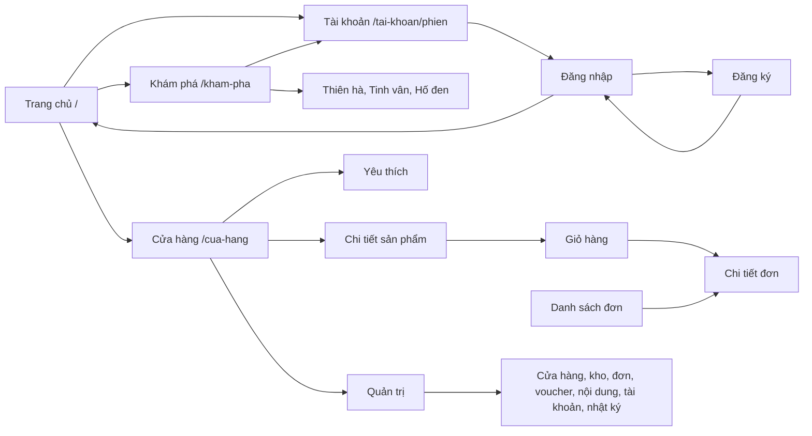

# Giao diện và điều hướng GALAXORA

[Về README chi tiết](../READMECHITIET.md#5-giao-diện-ui)

## 5.1. Cách chọn trang

[App.tsx](../frontend/src/app/App.tsx) đọc `window.location.pathname`. Route tài khoản dùng [duongDanTaiKhoan.ts](../frontend/src/pages/duongDanTaiKhoan.ts). Cửa hàng dùng [TrangBanHang.tsx](../frontend/src/banhang/TrangBanHang.tsx), Quản trị dùng [TrangQuanTri.tsx](../frontend/src/banhang/TrangQuanTri.tsx), còn Khám phá dùng [KhungKhamPha.tsx](../frontend/src/khampha/KhungKhamPha.tsx) và [khuVucVuTru.ts](../frontend/src/khampha/khuVucVuTru.ts). Các khu khám phá và màn hình tài khoản có điều hướng nội bộ bằng History API. Đường dẫn sản phẩm và đơn dùng ID nguyên dương. Các nhánh bán hàng và quản trị có thông báo không tìm thấy riêng.

## 5.2. Trang công khai và tài khoản

Trang Đăng nhập dùng nền vũ trụ liền mạch với Figure phi hành gia và khung kính. Trên điện thoại, minh họa thu gọn lên trên form. Các biểu mẫu xác thực khác dùng khung hai cột với minh họa Hệ Mặt Trời. Trang hồ sơ dùng bố cục riêng với các thẻ hồ sơ khám phá và bảo mật. Chân trang chung đầy đủ chia nhóm Khám phá, Cửa hàng và Tài khoản. Biểu mẫu đăng ký kiểm tra xác nhận mật khẩu và chuẩn hóa số điện thoại từ quốc gia đã chọn trước khi gửi. [GiaoDienTaiKhoan.tsx](../frontend/src/pages/GiaoDienTaiKhoan.tsx) · [KhungDangNhap.tsx](../frontend/src/pages/KhungDangNhap.tsx) · [TrangTaiKhoan.tsx](../frontend/src/pages/TrangTaiKhoan.tsx)

| Màn hình và URL | Nguồn | Khối giao diện trên xuống và hành động | Nguồn dữ liệu và trạng thái |
|---|---|---|---|
| Trang chủ `/` | [TrangChu.tsx](../frontend/src/pages/TrangChu.tsx) · [Các thành phần](../frontend/src/trangchu/) | Đầu trang, hero có nút Xem sản phẩm và Bắt đầu khám phá. Khu `#san-pham` có bốn ảnh nổi bật, 120 ảnh tham khảo chia bốn nhóm, tìm kiếm có hoặc không dấu, tải thêm từng lượt và hộp thoại xem ảnh. Tiếp theo là sản phẩm mới trong cửa hàng, bốn khu Khám phá, Hành trình của USER và chân trang. | Bộ ảnh dùng danh sách tệp cục bộ. Sản phẩm mới đọc từ `GET /api/cua-hang/san-pham?trang=0&kichThuoc=4&sapXep=moi`. Dùng chung trạng thái `GET /api/tai-khoan/phien`. Chỉ USER đọc `GET /api/nhiem-vu/ho-so`, tên huy hiệu bổ sung khi cần và `GET /api/gio-hang`. |
| Kiểm tra hệ thống `/he-thong` | [TrangKiemTraHeThong.tsx](../frontend/src/pages/TrangKiemTraHeThong.tsx) | Khung tối gọn, tiêu đề và thông báo kết nối. | GET `/api/he-thong/suc-khoe`. Đang kiểm tra, hoạt động hoặc không kết nối. Công khai. |
| Đăng nhập `/tai-khoan/dang-nhap` | [GiaoDienTaiKhoan.tsx](../frontend/src/pages/GiaoDienTaiKhoan.tsx) · [BieuMauTaiKhoan.tsx](../frontend/src/pages/BieuMauTaiKhoan.tsx) | Form email/số điện thoại, mật khẩu và liên kết đăng ký. Phiên có ADMIN mở `/quan-tri`. Phiên USER mở Trang chủ. | POST `/api/tai-khoan/dang-nhap`, GET `/api/tai-khoan/phien` để nhận biết đã đăng nhập. Lỗi sai thông tin hoặc quá nhiều lượt. |
| Đăng ký `/tai-khoan/dang-ky` | [BieuMauTaiKhoan.tsx](../frontend/src/pages/BieuMauTaiKhoan.tsx) | Họ tên, email, quốc gia mặc định Việt Nam (+84), số điện thoại, mật khẩu và xác nhận. Khi nhận 202, mở màn hình đăng nhập với email đã nhập. | POST `/api/tai-khoan/dang-ky` với số chuẩn E.164. |
| Tài khoản `/tai-khoan/phien` | [GiaoDienTaiKhoan.tsx](../frontend/src/pages/GiaoDienTaiKhoan.tsx) · [DoiMatKhau.tsx](../frontend/src/pages/DoiMatKhau.tsx) · [HoSoKhamPha.tsx](../frontend/src/pages/HoSoKhamPha.tsx) | Kiểm tra phiên, hiển thị ID/vai trò, sổ địa chỉ, đổi mật khẩu, hồ sơ USER và đăng xuất. Hồ sơ có cấp, XP, lịch sử, phần thưởng, thông báo và liên kết mở Hệ Mặt Trời. | `/api/tai-khoan/phien`, `/api/tai-khoan/dia-chi`, `/api/tai-khoan/doi-mat-khau`, `/api/tai-khoan/dang-xuat`, `/api/nhiem-vu/{ho-so,noi-dung,thong-bao}`. Đang kiểm tra, chuyển đăng nhập khi 401, báo lỗi và thử lại. Hồ sơ USER có trạng thái XP/phần thưởng/thông báo rỗng. |
| Không tìm thấy | [App.tsx](../frontend/src/app/App.tsx) · [TrangBanHang.tsx](../frontend/src/banhang/TrangBanHang.tsx) | Khung tối, thông báo và liên kết về Trang chủ hoặc Cửa hàng. | Nhánh UI khi pathname chưa được xử lý. |

Trong trang Tài khoản, form đổi mật khẩu yêu cầu mật khẩu hiện tại và xác nhận mật khẩu mới. Khi đổi thành công, giao diện đưa người dùng về trang đăng nhập. [DoiMatKhau.tsx](../frontend/src/pages/DoiMatKhau.tsx)

Nguồn ảnh và prompt ImageGen của trang Đăng nhập

Figure dùng ảnh sản phẩm `Tượng decor phi hành gia Chibi ngồi mặt trăng.jpg` từ thư mục Mô Hình Figure do người dùng chỉ định. ImageGen tích hợp xử lý nền trong suốt. [Figure WebP](../frontend/src/assets/figure-phi-hanh-gia.webp)

> Remove only the beige studio background of the supplied GALAXORA product photo. Return a clean cutout PNG with real transparent alpha and the entire original white chibi astronaut seated cross-legged, both V-sign hands, black mirrored visor, and its full textured gray cratered moon pedestal. Preserve source colors, precise silhouette, pose, fingers, visor reflections, and original sculpture details faithfully. Retain no floor or cast shadow outside the pedestal. Close framing with a little safety margin. No added lighting, glow, scenery, text, or objects.

Tấm nền vũ trụ được tạo bằng ImageGen tích hợp. Viền sáng, vòng quỹ đạo và biểu mẫu được dựng ở lớp giao diện. [Nền WebP](../frontend/src/assets/canh-vu-tru-dang-nhap.webp)

> Create a premium cinematic widescreen 16:9 environment plate for GALAXORA login UI. An immersive cobalt and violet outer space, matching the supplied UI reference's environmental direction: huge realistic Earthlike limb cropped along the far left with brilliant thin blue atmospheric rim, dark navy space with tiny pin stars, a luminous violet blue spiral galaxy running diagonally across the central upper background, a cropped violet ringed giant in the right upper corner and faint blue planet limb in the far lower right. Cratered lunar terrain across the bottom foreground with understated luminous purple crystals on the edges. A subtle raised dark lavender cratered ridge near x=30 percent and y=87 percent provides a landing surface for a separately composited white astronaut Figure. Leave the middle-left above that ridge clear for this figure and brand. Keep the central right rich dark violet and navy so a transparent login card can read. Photorealistic planet textures with cinematic soft bloom, depth, and luminous violet starlight. Background production plate only, no astronaut, people, type, words, logos, interface, cards, or buttons.

Trang chủ hiển thị thẻ chào mừng khi API phiên trả `401`. USER có liên kết Tài khoản, cấp, XP, tối đa bốn huy hiệu nhận gần nhất và số lượng giỏ. Menu Tài khoản dẫn đến Hồ sơ, thêm Yêu thích và Đơn hàng cho USER hoặc Quản trị cho ADMIN. Hai mục điều hướng Khám phá và Hành trình đều dẫn vào `/kham-pha`. Nút Xem chi tiết của USER dẫn tới `/tai-khoan/phien`.

Trên thẻ sản phẩm đủ điều kiện, USER có thể thêm một đơn vị bằng `POST /api/gio-hang/{id}` kèm CSRF. Giao diện đọc lại số lượng sau khi thành công. Khách được dẫn tới đăng nhập và sản phẩm hết hàng hoặc ngừng bán giữ liên kết chi tiết. Lỗi phiên, hồ sơ, tên huy hiệu, danh sách và giỏ có thông báo hoặc thao tác thử lại tùy trạng thái.

## 5.3. Cửa hàng và giao dịch

Khung bán hàng dùng đầu và chân trang chung, đồng thời đọc phiên để hiện liên kết phù hợp. Khách thấy Cửa hàng, Khám phá và Đăng nhập. USER có nút Giỏ riêng và mở Yêu thích, Đơn hàng từ menu Tài khoản. ADMIN mở Quản trị từ cùng menu. Khi dữ liệu cần phiên trả 401, component tải gợi ý đăng nhập. Mã 403 hiện thiếu quyền. Các lỗi mạng hoặc thao tác hiển thị ở khối phản hồi. [TrangBanHang.tsx](../frontend/src/banhang/TrangBanHang.tsx) · [dungChung.tsx](../frontend/src/banhang/dungChung.tsx)

| Màn hình và URL | Nguồn | Khối giao diện theo thứ tự và hành động | API và bảng chính |
|---|---|---|---|
| Danh sách `/cua-hang` | [CuaHang.tsx](../frontend/src/banhang/CuaHang.tsx) | Tiêu đề, form tìm theo tên/SKU, danh mục và sắp xếp, lưới sản phẩm, phân trang, popup Xem nhanh. Bấm thẻ hoặc Xem chi tiết về trang sản phẩm. Popup đóng bằng nút Đóng. Hiện lỗi danh mục, lỗi tải và kết quả rỗng. | GET `/api/cua-hang/danh-muc`, `/api/cua-hang/san-pham`. Đọc `danh_muc`, `san_pham`, `ton_kho`, ảnh và cờ mô hình. Công khai. |
| Yêu thích `/cua-hang/yeu-thich` | [CuaHang.tsx](../frontend/src/banhang/CuaHang.tsx) | Tiêu đề, thẻ sản phẩm, popup xem nhanh, trạng thái danh sách trống. Dùng chung bố cục cửa hàng, không hiện form lọc danh mục/sắp xếp. | GET `/api/cua-hang/yeu-thich`, bảng `yeu_thich`. USER. |
| Chi tiết sản phẩm `/cua-hang/san-pham/{id}` | [CuaHang.tsx](../frontend/src/banhang/CuaHang.tsx) · [XemMoHinh.tsx](../frontend/src/banhang/XemMoHinh.tsx) | Quay lại cửa hàng, vùng ảnh, tên/SKU/danh mục/giá/tồn, mô tả và thao tác. USER nhập số lượng để thêm giỏ và bật/tắt yêu thích, khách thấy liên kết đăng nhập. Bật xem 3D khi có mô hình, đặt lại góc nhìn, xem nguồn và giấy phép. Bên dưới là đánh giá và sản phẩm liên quan. Có trạng thái tải/lỗi chi tiết, mô hình và đánh giá. | GET chi tiết và đánh giá cùng tiền tố `/api/cua-hang/san-pham/{id}`; GET metadata và nội dung mô hình khi mở. PUT yêu thích và POST giỏ cần USER. Đọc `san_pham`, `hinh_anh_san_pham`, `mo_hinh_3d_san_pham`, `danh_gia`. |
| Giỏ và đặt COD `/gio-hang` | [GioHang.tsx](../frontend/src/banhang/GioHang.tsx) | Tiêu đề, các dòng sản phẩm, số lượng, Cập nhật/Xóa, nhập voucher và Tính tổng tiền, biểu mẫu nhận hàng rồi nút Đặt hàng COD. Chỉ đặt sau khi có báo giá. Thành công chuyển đến chi tiết đơn. Giỏ rỗng có liên kết Cửa hàng. | GET `/api/gio-hang`, PUT `/api/gio-hang/{id}`, GET `/api/gio-hang/tinh-tien`, POST `/api/don-hang`. USER, `gio_hang`, `chi_tiet_gio_hang`, `don_hang` và bảng giá/kho/voucher. |
| Danh sách đơn `/don-hang` | [DonHang.tsx](../frontend/src/banhang/DonHang.tsx) | Tiêu đề, các đơn có mã và trạng thái, nút trang trước/sau. Mã đơn mở chi tiết. Có tải, lỗi và trang rỗng. | GET `/api/don-hang`, bảng `don_hang`. USER, chỉ đơn của phiên. |
| Chi tiết đơn `/don-hang/{id}` | [DonHang.tsx](../frontend/src/banhang/DonHang.tsx) | Về danh sách, mã/trạng thái/COD, sản phẩm và tổng tiền, thông tin nhận, thao tác hủy nếu hợp lệ, lịch sử yêu cầu hủy và trạng thái, đánh giá sau giao. Khách xác nhận tự hủy qua hộp thoại hoặc nhập lý do xin hủy. Có phản hồi khi lưu đánh giá hoặc trạng thái hủy thay đổi. | GET `/api/don-hang/{id}`, POST `/huy` hoặc `/yeu-cau-huy` dưới cùng đường dẫn. GET/PUT `/api/danh-gia/*`. USER, chỉ đơn sở hữu. `don_hang`, `chi_tiet_don_hang`, `yeu_cau_huy_don`, `lich_su_trang_thai_don`, `danh_gia`. |

## 5.4. Quản trị

Các trang `/quan-tri` dùng khung riêng. Thanh bên mở các module và chỉ rõ mục hiện tại. Đầu trang có liên kết thông báo, mã tài khoản đang hoạt động và nút đăng xuất. Trên màn hình hẹp, menu nằm trong nút mở ở đầu trang. UI đọc phiên trước khi tải dữ liệu quản trị. API kiểm tra lại vai trò ADMIN. Phần tải và thao tác dùng `TrangThaiTai` và `PhanHoi`. [TrangQuanTri.tsx](../frontend/src/banhang/TrangQuanTri.tsx) · [CauHinhBaoMat.java](../backend/src/main/java/com/galaxora/cauhinh/CauHinhBaoMat.java)

| Màn hình và URL | Nguồn | Khối giao diện theo thứ tự và hành động | API và dữ liệu |
|---|---|---|---|
| Dashboard `/quan-tri` | [TongQuanQuanTri.tsx](../frontend/src/banhang/TongQuanQuanTri.tsx) | Banner với hình phi hành gia sẵn có, bốn thẻ vận hành, số nhiệm vụ hoàn thành và danh sách thông báo. Số đơn/yêu cầu hủy mở đơn hàng, số tồn thấp mở kho, thông báo mở trang liên quan. | GET `/api/quan-tri/tong-quan`, `/api/quan-tri/thong-bao`; đọc đơn, hủy, tồn, doanh thu cộng dồn từ đơn đã giao, nhiệm vụ/phần thưởng và giới hạn đăng nhập. |
| Danh mục và sản phẩm `/quan-tri/cua-hang` | [QuanTriCuaHang.tsx](../frontend/src/banhang/QuanTriCuaHang.tsx) | Form và danh sách danh mục, danh sách sản phẩm có phân trang và nút Sửa, form sản phẩm, mô hình và kiểm duyệt đánh giá khi đã chọn sản phẩm. Tạo/lưu, thêm/bỏ ảnh, tải/thay mô hình, duyệt/gỡ duyệt và ẩn/hiện đánh giá. Form sản phẩm khóa gửi khi thiếu danh mục. | `/api/quan-tri/cua-hang/*`; các bảng danh mục, sản phẩm, ảnh, mô hình, đánh giá và tồn. |
| Kho `/quan-tri/kho` | [QuanTriKho.tsx](../frontend/src/banhang/QuanTriKho.tsx) | Ngưỡng chung, bảng tồn, chi tiết kho theo dòng với form điều chỉnh và lịch sử, phiếu nhập mới, danh sách/chi tiết phiếu cũ. Lưu ngưỡng, thêm/bỏ dòng phiếu, ghi biến động, xem phiếu. Chưa có sản phẩm thì hiện liên kết tạo sản phẩm. | `/api/quan-tri/kho/*`; `ton_kho`, `giao_dich_kho`, `phieu_nhap_kho`, `chi_tiet_phieu_nhap`, `cau_hinh_ban_hang`. |
| Đơn và phí COD `/quan-tri/don-hang` | [DonHang.tsx](../frontend/src/banhang/DonHang.tsx) · [TrangQuanTri.tsx](../frontend/src/banhang/TrangQuanTri.tsx) | Danh sách đơn/phân trang, rồi form phí COD toàn quốc. Mã đơn mở chi tiết. Lưu phí cập nhật cấu hình. Trang danh sách có trạng thái rỗng. | GET `/api/quan-tri/don-hang`, GET/PUT `/api/quan-tri/don-hang/phi-van-chuyen`; `don_hang`, `cau_hinh_ban_hang`. |
| Chi tiết đơn Admin `/quan-tri/don-hang/{id}` | [DonHang.tsx](../frontend/src/banhang/DonHang.tsx) | Mã/trạng thái, sản phẩm, tổng tiền, người nhận, form chuyển trạng thái nếu còn bước, yêu cầu hủy, lịch sử. Chọn trạng thái, khai lý do theo trường hợp, xác nhận thu COD khi giao thành công. Duyệt/từ chối hủy với lý do. | GET chi tiết, POST `/trang-thai`, POST `/yeu-cau-huy/{yeuCauId}` dưới tiền tố chi tiết Admin. Ghi đơn, kho, hủy và lịch sử. |
| Voucher `/quan-tri/voucher` | [QuanTriHeThong.tsx](../frontend/src/banhang/QuanTriHeThong.tsx) · [QuanTriVoucher.tsx](../frontend/src/banhang/QuanTriVoucher.tsx) | Mẫu voucher hành trình, danh sách voucher, form tạo/sửa, lịch sử khi chọn voucher. Cấu hình loại giảm, hiệu lực, lượt, điều kiện và bật/tắt. Voucher cửa hàng có chủ sở hữu tùy chọn. | `/api/quan-tri/voucher-hanh-trinh` và `/api/quan-tri/voucher/*`; `cau_hinh_voucher_hanh_trinh`, `voucher`, `lich_su_su_dung_voucher`. |
| Nội dung `/quan-tri/noi-dung` | [QuanTriHeThong.tsx](../frontend/src/banhang/QuanTriHeThong.tsx) | Chọn nhóm/mã nội dung, sửa tên mô tả, form tạo nhiệm vụ, danh sách nhiệm vụ có thể mở để sửa và đặt mẫu voucher, cuối cùng form chọn/tạo/sửa sự kiện. Điều kiện nhiệm vụ đổi các trường thiên thể/chương theo lựa chọn. | `/api/quan-tri/noi-dung/*`, `/api/quan-tri/nhiem-vu/*`, `/api/quan-tri/su-kien/*`; các bảng nội dung, nhiệm vụ, mẫu voucher và sự kiện. |
| Tài khoản `/quan-tri/tai-khoan` | [QuanTriHeThong.tsx](../frontend/src/banhang/QuanTriHeThong.tsx) | Form tìm tên/email/số điện thoại, danh sách và phân trang, nút khóa/mở khóa có xác nhận. Hiện phản hồi sau thao tác. | GET `/api/quan-tri/tai-khoan`, PUT `/api/quan-tri/tai-khoan/{id}/khoa`; `nguoi_dung` và vai trò. |
| Nhật ký `/quan-tri/nhat-ky` | [QuanTriHeThong.tsx](../frontend/src/banhang/QuanTriHeThong.tsx) | Form khoảng ngày UTC, thao tác, ID Admin, danh sách kết quả và phân trang. Nút lọc tải lại trang kết quả. | GET `/api/quan-tri/nhat-ky`; `nhat_ky_quan_tri`. |

## 5.5. Khám phá 3D và 2D

[KhungKhamPha.tsx](../frontend/src/khampha/KhungKhamPha.tsx) dùng đầu trang gọn bên trong vùng toàn màn hình. Thanh khu vực nằm ở đáy, nút toàn màn hình xuất hiện khi trình duyệt hỗ trợ. Chuyển khu vực bằng History API, hỗ trợ Quay lại/Tiến, dùng `Suspense` khi tải module. Mỗi khu công khai. Bảng tiến độ cần USER và chỉ xuất hiện trong Hệ Mặt Trời.

| Màn hình | Nguồn | Khối chính, thao tác và trạng thái | Dữ liệu |
|---|---|---|---|
| Hệ Mặt Trời `/kham-pha` | [TrangKhamPha.tsx](../frontend/src/khampha/TrangKhamPha.tsx) · [CanhHeMatTroi.tsx](../frontend/src/khampha/CanhHeMatTroi.tsx) | Tiêu đề, cảnh mô phỏng hoặc Cảnh gốc, điều khiển Toàn cảnh/Từ trên/Tạm dừng/tốc độ, bảng thông tin sau khi chọn, danh sách 11 thiên thể, tiến độ Hành trình và thanh khu vực. Chọn thiên thể điều hướng camera và tải GLB chi tiết. Lỗi GLB chi tiết giữ mô phỏng. WebGL lỗi dùng sơ đồ 2D có thể chọn. | [thienThe.ts](../frontend/src/khampha/thienThe.ts), [soLieuNasa.ts](../frontend/src/khampha/soLieuNasa.ts), [taiNguyenHeMatTroi.ts](../frontend/src/khampha/taiNguyenHeMatTroi.ts) và GET `/api/kham-pha/noi-dung`. Các file số liệu là nội dung tĩnh trong mã. |
| Hành trình, nằm trong `/kham-pha` | [TienDoKhamPha.tsx](../frontend/src/khampha/TienDoKhamPha.tsx) | Số thiên thể, chương mở/khóa/xong, danh sách nhiệm vụ, nút nhận voucher nếu đang chờ, dấu hiệu có thể thao tác khi đủ điều kiện. Mở bảng thông tin thiên thể có thể ghi khám phá cả trong 2D. Hiển thị phản hồi lỗi trong bảng Hành trình; hộp này chỉ render cho vai trò USER. | Phiên và `/api/nhiem-vu/{noi-dung,doi-chieu,kham-pha/{ma},dau-hieu,vat-the-an,voucher}`; `lich_su_xp`, `lich_su_phan_thuong`, nhiệm vụ và mẫu voucher. |
| Thiên hà `/kham-pha/thien-ha` | [TrangKhuVucVuTru.tsx](../frontend/src/khampha/TrangKhuVucVuTru.tsx) · [CanhKhuVucVuTru.tsx](../frontend/src/khampha/CanhKhuVucVuTru.tsx) | Tiêu đề, cảnh, thao tác xoay, phóng to/thu nhỏ và đặt lại, bảng kiến thức thu gọn, nguồn và ghi công. Tải GLB, dự phòng ảnh khi WebGL lỗi. | [khuVucVuTru.ts](../frontend/src/khampha/khuVucVuTru.ts), GLB và ảnh dưới `assets/3d/galaxies/`, GET `/api/kham-pha/noi-dung`. |
| Tinh vân `/kham-pha/tinh-van` | [TrangKhuVucVuTru.tsx](../frontend/src/khampha/TrangKhuVucVuTru.tsx) · [CanhKhuVucVuTru.tsx](../frontend/src/khampha/CanhKhuVucVuTru.tsx) | Tiêu đề, cảnh xem 360°, kéo/phím để xoay góc nhìn và đặt lại, bảng kiến thức và ghi công. Có tải và ảnh 2D dự phòng. | [khuVucVuTru.ts](../frontend/src/khampha/khuVucVuTru.ts), `assets/3d/nebulae/` và GET `/api/kham-pha/noi-dung`. |
| Hố đen `/kham-pha/ho-den` | [TrangKhuVucVuTru.tsx](../frontend/src/khampha/TrangKhuVucVuTru.tsx) · [CanhKhuVucVuTru.tsx](../frontend/src/khampha/CanhKhuVucVuTru.tsx) | Tiêu đề, cảnh xoay/thu phóng và đặt lại, bảng kiến thức, nguồn, ghi công. Dự phòng ảnh khi lỗi WebGL. | [khuVucVuTru.ts](../frontend/src/khampha/khuVucVuTru.ts), `assets/3d/black-holes/` và GET `/api/kham-pha/noi-dung`. |

## 5.6. Thành phần dùng chung

| Thành phần | Trách nhiệm | Nguồn |
|---|---|---|
| `KhungTrang`, `ThanhDauTrang`, `ChanTrang` | Khung nền sao, đầu trang, một landmark nội dung chính và chân trang tùy chọn. Đầu trang dùng trạng thái phiên do trang cung cấp. Trang chủ truyền thêm số lượng giỏ đã đọc. | [giaodien](../frontend/src/giaodien/) |
| `useDuLieu`, `useThaoTac` | Đọc dữ liệu có hủy truy vấn khi đổi màn hình, tải lại, phản hồi thao tác và trạng thái gửi. | [dungChung.tsx](../frontend/src/banhang/dungChung.tsx) |
| `TrangThaiTai`, `PhanHoi`, `Khoi` | Hiển thị tải, thông báo, lỗi và panel có tiêu đề. | [dungChung.tsx](../frontend/src/banhang/dungChung.tsx) |
| `PhanTrang`, `ChiPhi` | Nút trang trước/sau, bảng tạm tính, giảm, phí và tổng. | [dungChung.tsx](../frontend/src/banhang/dungChung.tsx) |
| Form tài khoản và đổi mật khẩu | Dùng chung cho đăng ký và đăng nhập. Đổi mật khẩu ở trang phiên. | [BieuMauTaiKhoan.tsx](../frontend/src/pages/BieuMauTaiKhoan.tsx) · [DoiMatKhau.tsx](../frontend/src/pages/DoiMatKhau.tsx) |
| `XemMoHinh` | Viewer sản phẩm tải lười, kéo/xoay/thu phóng, ghi công, trạng thái WebGL. | [XemMoHinh.tsx](../frontend/src/banhang/XemMoHinh.tsx) |
| Khung khám phá và bộ dựng | Quản lý chuyển cảnh/toàn màn hình. Bộ dựng quản lý camera, ResizeObserver và giải phóng tài nguyên khi rời cảnh. | [KhungKhamPha.tsx](../frontend/src/khampha/KhungKhamPha.tsx) · [lapCanhHeMatTroi.ts](../frontend/src/khampha/lapCanhHeMatTroi.ts) · [CanhKhuVucVuTru.tsx](../frontend/src/khampha/CanhKhuVucVuTru.tsx) |

## 5.7. Hệ thống thiết kế và truy cập

| Nhóm | Kiểu dáng và responsive | Nguồn |
|---|---|---|
| Trang chủ | Nền chuyển màu navy, xanh và tím, nút cyan–tím, thẻ kính, phông hệ thống. Bố cục đổi ở 900 và 600 px. | [Token dùng chung](../frontend/src/giaodien/bienThietKe.css) · [trangChu.css](../frontend/src/pages/trangChu.css) · [Quy tắc giao diện](design-system.md#trang-chủ) |
| Cửa hàng/Admin | Thẻ, bộ lọc, bảng và liên kết dùng cùng bộ màu. Bố cục nhiều cột đổi tại `720px`. Font hệ thống. | [banHang.css](../frontend/src/banhang/banHang.css) |
| Khám phá | Biến `--kp-*` lấy màu từ `--gx-*` và bố trí panel theo chiều cao đầu trang. Breakpoint `700px`, điều chỉnh theo `prefers-reduced-motion`. | [khamPha.css](../frontend/src/khampha/khamPha.css) · [TrangKhamPha.tsx](../frontend/src/khampha/TrangKhamPha.tsx) |
| Tài khoản | Khung form kính hai cột, dùng system-ui và thanh XP chung, breakpoint `48rem`. | [taiKhoan.css](../frontend/src/pages/taiKhoan.css) |
| Toàn ứng dụng | `lang="vi"`, nhãn giao diện tiếng Việt và một số số/giờ được định dạng `vi-VN`. Tải CSS tổng qua entry. Không có cấu hình chuyển locale trong các điểm vào đã đọc. Có `role="status"`, `role="alert"`, nhãn form và điều khiển bàn phím ở các màn hình nêu trên. | [index.html](../frontend/index.html) · [main.tsx](../frontend/src/main.tsx) · [index.css](../frontend/src/index.css) · [duLieu.ts](../frontend/src/banhang/duLieu.ts) |
