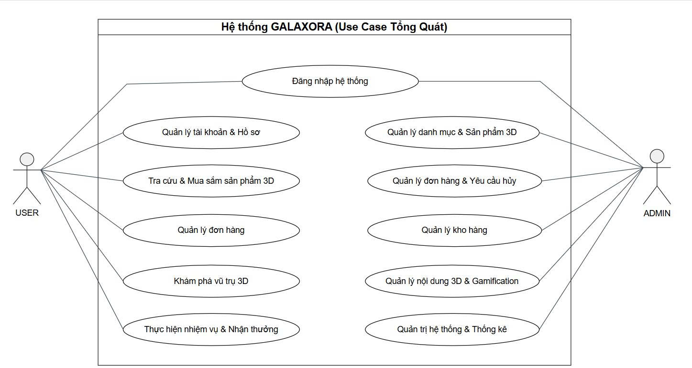
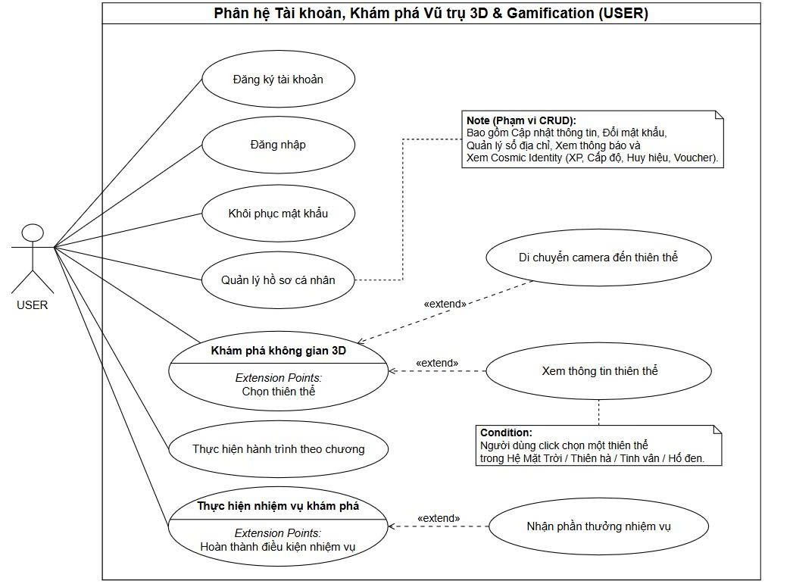
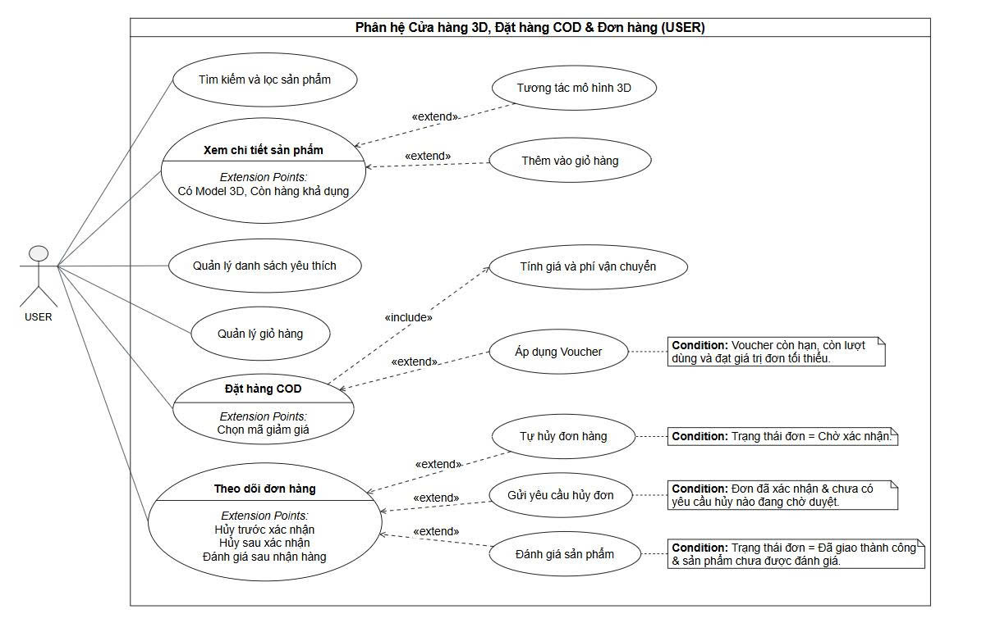
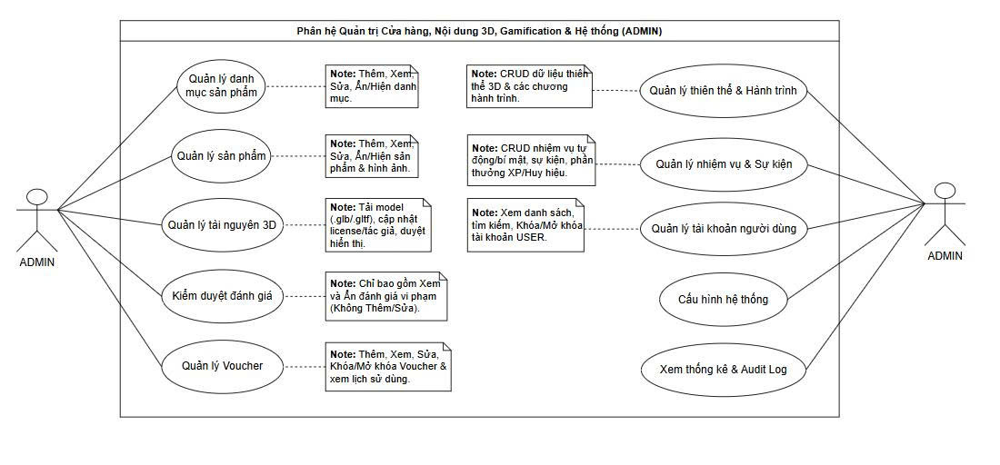
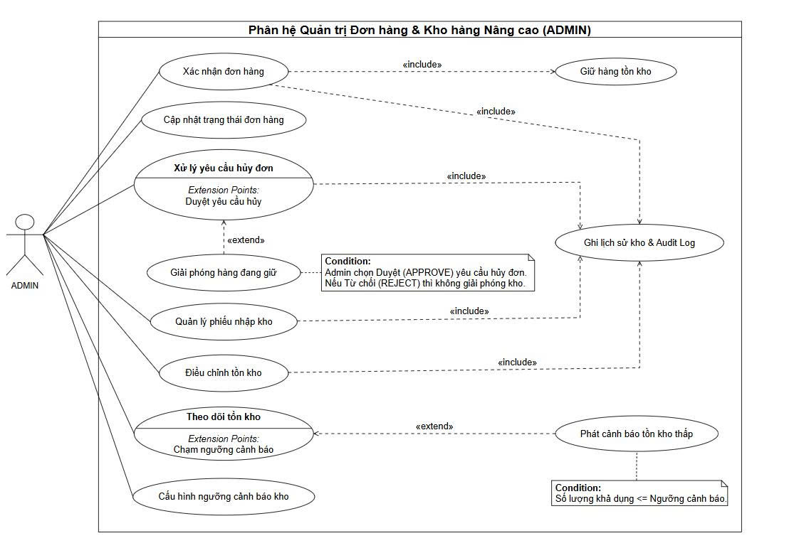

# Yêu cầu hệ thống — GALAXORA

> **Phiên bản:** 0.3 (bản nháp, **chờ người dùng duyệt**)
> **Ngày:** 11/11/2026
> **Nguồn:** `plan.md` (bản 1.3, 11/11/2026), 5 sơ đồ use case trong `docs/usecase/` và các quyết định của người dùng ngày 10/11 và 11/11/2026 (mục 8).
> Ngoài các quyết định đó, tài liệu này **không thêm tính năng mới**. Mỗi yêu cầu ghi rõ nguồn. Những điểm sơ đồ và `plan.md` chưa khớp, hoặc chưa đủ thông tin, nằm ở mục 6 và 7; không được tự suy đoán.

## 1. Quy ước

- Mã yêu cầu: `TK` (tài khoản), `CH` (cửa hàng), `GH` (giỏ hàng/đặt hàng), `KHO`, `VC` (voucher), `3D`, `GM` (gamification), `TB` (thông báo/quản trị), `PCN` (phi chức năng).
- Cột "Nguồn": số mục trong `plan.md` hoặc tên sơ đồ.
- Trạng thái chung: tất cả yêu cầu ở trạng thái **Chờ duyệt**.

## 2. Tác nhân

| Tác nhân | Mô tả | Nguồn |
|---|---|---|
| Khách truy cập | Xem toàn bộ nội dung công khai (cửa hàng, chi tiết sản phẩm, khám phá 3D) như website bán hàng thông thường. Giỏ hàng, yêu thích, đặt hàng, đánh giá, nhiệm vụ và XP yêu cầu đăng nhập. | plan 2.4 (bản 1.1) |
| USER | Đăng ký, đăng nhập, mua hàng, quản lý hồ sơ, tham gia nhiệm vụ, tích lũy XP, nhận phần thưởng. | plan 2.4, 4.1 |
| ADMIN | Quản lý và vận hành toàn bộ hệ thống. | plan 2.4, 4.1 |

> Lưu ý: 5 sơ đồ hiện chỉ có USER và ADMIN, chưa có tác nhân Khách truy cập (xem mục 6, điểm D1). Quyền luôn được kiểm tra ở backend (plan 4.1).

## 3. Use case

### 3.1. Tổng quát

| Tác nhân | Use case cấp cao |
|---|---|
| USER và ADMIN | Đăng nhập hệ thống |
| USER | Quản lý tài khoản & Hồ sơ · Tra cứu & Mua sắm sản phẩm 3D · Quản lý đơn hàng · Khám phá vũ trụ 3D · Thực hiện nhiệm vụ & Nhận thưởng |
| ADMIN | Quản lý danh mục & Sản phẩm 3D · Quản lý đơn hàng & Yêu cầu hủy · Quản lý kho hàng · Quản lý nội dung 3D & Gamification · Quản trị hệ thống & Thống kê |

### 3.2. Phân hệ Tài khoản, Khám phá vũ trụ 3D & Gamification (USER)

| Use case | Quan hệ / điều kiện ghi trên sơ đồ |
|---|---|
| Đăng ký tài khoản | — |
| Đăng nhập | — |
| Khôi phục mật khẩu | — |
| Quản lý hồ sơ cá nhân | Phạm vi: cập nhật thông tin, đổi mật khẩu, quản lý sổ địa chỉ, xem thông báo, xem Cosmic Identity (XP, cấp độ, huy hiệu, voucher) |
| Khám phá không gian 3D | Extension point: Chọn thiên thể. «extend»: Di chuyển camera đến thiên thể; Xem thông tin thiên thể |
| Xem thông tin thiên thể | Điều kiện: người dùng click chọn một thiên thể trong Hệ Mặt Trời / Thiên hà / Tinh vân / Hố đen |
| Thực hiện hành trình theo chương | — |
| Thực hiện nhiệm vụ khám phá | Extension point: Hoàn thành điều kiện nhiệm vụ. «extend»: Nhận phần thưởng nhiệm vụ |

Phạm vi tương tác đã duyệt ngày 12/11/2026 được ghi tại 3D-01, 3D-04 và D12 bên dưới.

### 3.3. Phân hệ Cửa hàng 3D, Đặt hàng COD & Đơn hàng (USER)

| Use case | Quan hệ / điều kiện ghi trên sơ đồ |
|---|---|
| Tìm kiếm và lọc sản phẩm | — |
| Xem chi tiết sản phẩm | Extension points: Có Model 3D, Còn hàng khả dụng. «extend»: Tương tác mô hình 3D; Thêm vào giỏ hàng |
| Quản lý danh sách yêu thích | — |
| Quản lý giỏ hàng | — |
| Đặt hàng COD | Extension point: Chọn mã giảm giá. «include»: Tính giá và phí vận chuyển. «extend»: Áp dụng Voucher |
| Áp dụng Voucher | Điều kiện: voucher còn hạn, còn lượt dùng và đạt giá trị đơn tối thiểu |
| Theo dõi đơn hàng | Extension points: Hủy trước xác nhận, Hủy sau xác nhận, Đánh giá sau nhận hàng |
| Tự hủy đơn hàng | Điều kiện: trạng thái đơn = Chờ xác nhận |
| Gửi yêu cầu hủy đơn | Điều kiện: đơn đã xác nhận và chưa có yêu cầu hủy nào đang chờ duyệt |
| Đánh giá sản phẩm | Điều kiện: trạng thái đơn = Đã giao thành công và sản phẩm chưa được đánh giá |

### 3.4. Phân hệ Quản trị Cửa hàng, Nội dung 3D, Gamification & Hệ thống (ADMIN)

| Use case | Ghi chú trên sơ đồ |
|---|---|
| Quản lý danh mục sản phẩm | Thêm, Xem, Sửa, Ẩn/Hiện danh mục |
| Quản lý sản phẩm | Thêm, Xem, Sửa, Ẩn/Hiện sản phẩm và hình ảnh |
| Quản lý tài nguyên 3D | Tải model (.glb/.gltf), cập nhật license/tác giả, duyệt hiển thị |
| Kiểm duyệt đánh giá | Chỉ gồm Xem và Ẩn đánh giá vi phạm (không Thêm/Sửa) |
| Quản lý Voucher | Thêm, Xem, Sửa, Khóa/Mở khóa voucher và xem lịch sử sử dụng |
| Quản lý thiên thể & Hành trình | CRUD dữ liệu thiên thể 3D và các chương hành trình |
| Quản lý nhiệm vụ & Sự kiện | CRUD nhiệm vụ tự động/bí mật, sự kiện, phần thưởng XP/Huy hiệu |
| Quản lý tài khoản người dùng | Xem danh sách, tìm kiếm, Khóa/Mở khóa tài khoản USER |
| Cấu hình hệ thống | — |
| Xem thống kê & Audit Log | — |

### 3.5. Phân hệ Quản trị Đơn hàng & Kho hàng Nâng cao (ADMIN)

| Use case | Quan hệ / điều kiện ghi trên sơ đồ |
|---|---|
| Xác nhận đơn hàng | «include»: Giữ hàng tồn kho; Ghi lịch sử kho & Audit Log |
| Cập nhật trạng thái đơn hàng | — |
| Xử lý yêu cầu hủy đơn | Extension point: Duyệt yêu cầu hủy. «include»: Ghi lịch sử kho & Audit Log |
| Giải phóng hàng đang giữ | «extend» của Xử lý yêu cầu hủy đơn. Điều kiện: Admin chọn Duyệt (APPROVE). Nếu Từ chối (REJECT) thì không giải phóng kho |
| Quản lý phiếu nhập kho | «include»: Ghi lịch sử kho & Audit Log |
| Điều chỉnh tồn kho | «include»: Ghi lịch sử kho & Audit Log |
| Theo dõi tồn kho | Extension point: Chạm ngưỡng cảnh báo |
| Phát cảnh báo tồn kho thấp | «extend» của Theo dõi tồn kho. Điều kiện: số lượng khả dụng ≤ ngưỡng cảnh báo |
| Cấu hình ngưỡng cảnh báo kho | — |

## 4. Yêu cầu chức năng

### 4.1. Tài khoản và hồ sơ

| Mã | Yêu cầu | Nguồn |
|---|---|---|
| TK-01 | Đăng ký bằng họ tên, email, số điện thoại, mật khẩu. Biểu mẫu có ô chọn quốc gia kèm mã gọi và ô xác nhận mật khẩu. Email và số điện thoại phải duy nhất. Tài khoản đăng nhập được ngay sau khi tạo. | plan 4.2 |
| TK-02 | Mật khẩu băm bằng BCrypt, không lưu dạng rõ. Không cho người dùng tự gán vai trò ADMIN. | plan 4.2 |
| TK-03 | Đã bỏ yêu cầu xác minh và gửi mã qua email. | plan 3.2; quyết định 19/11/2026 |
| TK-04 | Tài khoản đang mở khóa đăng nhập bằng email hoặc số điện thoại cùng mật khẩu. Phiên có quyền ADMIN mở khu vực Quản trị tại `/quan-tri`. Phiên USER mở Trang chủ. Có đăng xuất và dùng phiên phía server qua cookie. Không có social login. | plan 4.3, 3.2; quyết định 18/11/2026 |
| TK-05 | Người dùng đang đăng nhập có thể đổi mật khẩu bằng mật khẩu hiện tại. Khôi phục mật khẩu đã quên chờ chốt phương án xác minh. | plan 4.3, 19.2 |
| TK-06 | Tự đổi email hoặc số điện thoại đăng nhập chờ chốt phương án xác minh. | plan 4.3, 19.2 |
| TK-07 | Giới hạn tần suất đăng nhập; không tiết lộ tài khoản có tồn tại hay không qua thông báo lỗi. | plan 4.3 |
| TK-08 | Admin khóa/mở khóa, xem danh sách và tìm kiếm tài khoản USER. | plan 4.3; sơ đồ 3.4 |
| TK-09 | Hồ sơ Cosmic Identity có thể gồm: ảnh đại diện, Explorer ID, tên hiển thị, cấp độ và tổng XP, huy hiệu, nhiệm vụ đã hoàn thành, khám phá đã ghi nhận, bộ sưu tập, voucher đang sở hữu, lịch sử đơn hàng, danh sách yêu thích, sổ địa chỉ. | plan 4.4; sơ đồ 3.2 |

### 4.2. Cửa hàng và sản phẩm

| Mã | Yêu cầu | Nguồn |
|---|---|---|
| CH-01 | Admin tạo, sửa, ẩn/hiện danh mục. Danh mục không hard-code ở frontend. Tên nhóm trong plan chỉ là ví dụ. | plan 5.1; sơ đồ 3.4 |
| CH-02 | Admin quản lý sản phẩm: SKU, tên, danh mục, mô tả ngắn/chi tiết, giá bán, giá so sánh (nếu có), trạng thái hiển thị và kinh doanh, thông tin tồn kho, hình ảnh, mô hình 3D (nếu có), thời điểm tạo/cập nhật. | plan 5.2; sơ đồ 3.4 |
| CH-03 | Phía người dùng: tìm kiếm, lọc theo danh mục và thuộc tính phù hợp, sắp xếp, phân trang, trang chi tiết, hiển thị còn hàng/hết hàng. | plan 5.2; sơ đồ 3.3 |
| CH-04 | Xem nhanh và sản phẩm liên quan thuộc phạm vi; chưa có trên sơ đồ, không cần vẽ thêm (xem D6). Không làm lịch sử xem gần đây. | plan 5.2; quyết định 11/11 (mục 8) |
| CH-05 | Xem và tương tác mô hình 3D với sản phẩm có model hợp lệ, dùng viewer nội bộ (không mặc định iframe). | plan 5.2, 5.3; sơ đồ 3.3 |
| CH-06 | Mỗi mô hình 3D có metadata: tên file, sản phẩm liên kết, định dạng, dung lượng, license, nguồn, tác giả/attribution, trạng thái duyệt. Admin tải model, cập nhật license/tác giả, duyệt hiển thị. | plan 5.3; sơ đồ 3.4 |
| CH-07 | Danh sách yêu thích: USER thêm/xóa sản phẩm. | plan 5.5; sơ đồ 3.3 |
| CH-08 | Chỉ người mua đã nhận hàng thành công được đánh giá, một đánh giá cho mỗi sản phẩm và mỗi đơn của họ. Khi sửa, lưu bản trước và giữ trạng thái hiển thị hiện tại. | plan 5.4; sơ đồ 3.3; quyết định 10/11 và 12/11 |
| CH-09 | Admin chỉ xem và ẩn đánh giá vi phạm; không thêm/sửa đánh giá. | plan 5.4; sơ đồ 3.4 |

### 4.3. Giỏ hàng, đặt hàng, thanh toán COD

| Mã | Yêu cầu | Nguồn |
|---|---|---|
| GH-01 | Thêm, cập nhật số lượng, xóa sản phẩm trong giỏ. Backend kiểm tra sản phẩm còn kinh doanh và số lượng hợp lệ. Mỗi người dùng có một giỏ hàng hoạt động. | plan 6.1; quyết định 10/11 (mục 8) |
| GH-02 | Không tin giá/tổng tiền từ frontend. Khi checkout, backend tính lại giá, voucher, phí vận chuyển, tổng tiền. | plan 6.1; sơ đồ 3.3 |
| GH-03 | Đơn hàng lưu: mã đơn, người đặt, người nhận, SĐT nhận, địa chỉ giao (snapshot), danh sách sản phẩm, đơn giá snapshot, số lượng, tạm tính, giảm giá, phí vận chuyển snapshot, tổng thanh toán, phương thức COD, trạng thái, ghi chú, thời điểm tạo/cập nhật. | plan 6.2 |
| GH-04 | Chỉ hỗ trợ COD. Tạo đơn không đồng nghĩa đã thu tiền; trạng thái thanh toán tách riêng khỏi trạng thái đơn. Không tích hợp cổng thanh toán trực tuyến. | plan 6.3, 3.2 |
| GH-05 | Trạng thái đơn đề xuất: `CHO_XAC_NHAN`, `DA_XAC_NHAN`, `DANG_CHUAN_BI`, `DANG_GIAO`, `DA_GIAO_THANH_CONG`, `DA_HUY`, `GIAO_THAT_BAI`. Lưu lịch sử trạng thái; backend chỉ cho phép chuyển trạng thái hợp lệ. Khi `GIAO_THAT_BAI`: giải phóng ngay hàng đang giữ của đơn, đơn kết thúc, không giao lại. | plan 6.4; quyết định 10/11 (mục 8) |
| GH-06 | Một mức phí vận chuyển COD cố định áp dụng toàn quốc. Admin cấu hình giá trị trước khi mở đặt hàng. | plan 6.3, 19.1, 19.2 |
| GH-07 | **Hủy trước xác nhận:** USER tự hủy khi đơn `CHO_XAC_NHAN`; không cần giải phóng hàng vì chưa giữ. | plan 6.5; sơ đồ 3.3 |
| GH-08 | Từ `DA_XAC_NHAN` đến hết `DANG_CHUAN_BI`, USER gửi lý do hủy. Admin duyệt để hủy đơn và giải phóng hàng, hoặc từ chối để đơn tiếp tục. Kho tiếp tục giữ hàng khi yêu cầu đang chờ duyệt. | plan 6.5; sơ đồ 3.3, 3.5; quyết định 12/11 |
| GH-09 | Ràng buộc hủy: chỉ một yêu cầu hủy đang chờ cho mỗi đơn; không duyệt cùng yêu cầu nhiều lần; kiểm tra trạng thái đơn cho phép; không hủy đơn đã giao thành công theo luồng hủy thông thường; lưu người xử lý, thời gian, lý do, lịch sử; ghi audit log; cập nhật đơn/yêu cầu/kho trong một transaction. Trạng thái yêu cầu hủy quản lý riêng khỏi trạng thái đơn. | plan 6.4, 6.5 |
| GH-10 | Admin xác nhận đơn, cập nhật trạng thái đơn, xử lý yêu cầu hủy. | sơ đồ 3.5; plan 11.4 |
| GH-11 | Admin được hủy đơn đang `CHO_XAC_NHAN`, kèm lý do và ghi audit log; vì chưa giữ hàng nên không giải phóng kho. Chưa có trên sơ đồ (xem D13). | plan 11.5, 6.5; quyết định 10/11 (mục 8) |

### 4.4. Kho hàng (nâng cao)

| Mã | Yêu cầu | Nguồn |
|---|---|---|
| KHO-01 | Quản lý nhập kho, xuất kho, tồn kho, hàng đang giữ, hàng khả dụng, lịch sử biến động, cảnh báo tồn kho thấp/hết hàng. | plan 7.1 |
| KHO-02 | Phân biệt `so_luong_thuc_te`, `so_luong_dang_giu`, `so_luong_kha_dung = so_luong_thuc_te - so_luong_dang_giu`. | plan 7.2 |
| KHO-03 | Tạo đơn chưa giữ hàng. Admin xác nhận: backend kiểm tra tồn kho, nếu đủ thì giữ hàng trong cùng transaction. Giao thành công: ghi nhận xuất bán/giảm hàng thực tế và kết thúc giữ. Hủy được duyệt hoặc giao thất bại: giải phóng lượng giữ của đơn đó. Khi Admin xác nhận mà tồn kho không đủ: chặn xác nhận và báo lỗi rõ cho Admin; đơn vẫn `CHO_XAC_NHAN`; không xác nhận một phần, không tự hủy. | plan 7.3; quyết định 10/11 (mục 8) |
| KHO-04 | Mọi nhập, xuất, điều chỉnh, giữ, giải phóng đều có bản ghi lịch sử; không sửa trực tiếp số tồn nếu không có lý do và lịch sử điều chỉnh. | plan 7.5; sơ đồ 3.5 |
| KHO-05 | Không để hai đơn cùng giữ vượt số lượng khả dụng (transaction, khóa/kiểm soát đồng thời). Giải phóng đúng số lượng đã giữ của đơn đó. | plan 7.5 |
| KHO-06 | Admin nhận cảnh báo khi tồn kho thấp/hết; khách thấy trạng thái còn hàng / sắp hết / hết hàng theo ngưỡng cấu hình. Sơ đồ ghi điều kiện cảnh báo: khả dụng ≤ ngưỡng. Dùng một ngưỡng chung, một giá trị toàn hệ thống do Admin cấu hình (không đặt theo sản phẩm, không khóa cứng giá trị). | plan 7.4; sơ đồ 3.5; quyết định 10/11 (mục 8) |
| KHO-07 | Admin quản lý phiếu nhập kho, điều chỉnh tồn kho, cấu hình ngưỡng cảnh báo. | sơ đồ 3.5 |

### 4.5. Voucher

| Mã | Yêu cầu | Nguồn |
|---|---|---|
| VC-01 | Hai nguồn: voucher Admin tạo và voucher nhận từ nhiệm vụ/khám phá. | plan 8.1 |
| VC-02 | Thuộc tính: mã, loại giảm (phần trăm/số tiền), giá trị giảm, mức giảm tối đa (nếu có), giá trị đơn tối thiểu (nếu có), thời gian bắt đầu/kết thúc, số lượt tối đa, số lượt đã dùng, điều kiện áp dụng, trạng thái, người sở hữu (nếu cá nhân). | plan 8.2 |
| VC-03 | Backend xác minh điều kiện (còn hạn, còn lượt, đạt giá trị tối thiểu); không tin số tiền giảm từ client; không vượt quota; ghi lịch sử sử dụng. Khi đơn bị hủy, voucher không được hoàn lại lượt dùng. | plan 8.3; sơ đồ 3.3; quyết định 10/11 (mục 8) |
| VC-04 | Admin thêm, xem, sửa, khóa/mở khóa voucher và xem lịch sử sử dụng. | sơ đồ 3.4 |

### 4.6. Khám phá vũ trụ 3D

| Mã | Yêu cầu | Nguồn |
|---|---|---|
| 3D-01 | Bốn khu vực: Solar System, Galaxy Explorer, Nebula Explorer, Black Hole Explorer. Phong cách Cinematic Realism; dữ liệu khoa học quan trọng phải chính xác. Thiên hà xoay và thu phóng toàn cảnh, Tinh vân xem nền 360°, Hố đen xoay và thu phóng mô hình. Cả ba có thông tin cơ bản, ưu tiên NASA và ghi nguồn. Bốn khu vực phủ khung trình duyệt, có nút toàn màn hình, khung chuyển khu vực có hiệu ứng và bảng thông tin thu gọn. Hiển thị các mô hình gốc người dùng cung cấp. | plan 9.1, 9.2; quyết định 12/11/2026 |
| 3D-02 | Hệ Mặt Trời gồm Mặt Trời, 8 hành tinh, Pluto (hành tinh lùn) và Mặt Trăng; có quỹ đạo, tự quay, quay quanh Mặt Trời ở tốc độ mô phỏng; có điều khiển tốc độ mô phỏng và góc nhìn; không yêu cầu tỷ lệ tuyệt đối, ghi rõ đây là mô phỏng. | plan 9.3 (bản 1.1) |
| 3D-03 | Camera Hybrid: tự do xoay/zoom/điều hướng và chọn thiên thể để camera tự động dẫn đến. Chuyển động mượt, có thể kiểm soát, không gây mất phương hướng. | plan 9.4; sơ đồ 3.2 |
| 3D-04 | Chọn bất kỳ thiên thể nào trong Hệ Mặt Trời thì camera zoom vào mô hình 3D chi tiết, chân thực của thiên thể đó và hiển thị panel thông tin. | plan 9.3 (bản 1.1); sơ đồ 3.2 |
| 3D-05 | Tài nguyên Mixed: model/texture có sẵn kết hợp code hiệu ứng, ánh sáng, chuyển động; không phụ thuộc hoàn toàn một nguồn hay iframe ngoài. | plan 9.5 |
| 3D-06 | Hiệu năng: lazy loading theo khu vực, LOD, tối ưu texture/model, instancing, frustum culling, adaptive quality, cache, giải phóng tài nguyên GPU, chế độ giảm hiệu ứng/fallback khi không có WebGL. Mục tiêu tham khảo 60 FPS máy phổ thông, 30 FPS ổn định thiết bị yếu (mục tiêu kiểm thử, không phải cam kết). | plan 9.7 |
| 3D-07 | Lưu metadata nguồn, tác giả, license, attribution; kiểm tra quyền sử dụng trước khi đưa vào website. | plan 9.8 |
| 3D-08 | Admin CRUD dữ liệu thiên thể 3D và các chương hành trình. | sơ đồ 3.4 |
| 3D-09 | Người dùng thực hiện hành trình theo chương, mở khóa dần. | plan 10.1; sơ đồ 3.2 |

### 4.7. Gamification

| Mã | Yêu cầu | Nguồn |
|---|---|---|
| GM-01 | Nhiệm vụ tự động ghi nhận tiến độ; có nhiệm vụ bí mật; một phần nội dung là hành trình theo chương. Khám phá không bắt buộc mua hàng. | plan 10.1 |
| GM-02 | Nhóm nhiệm vụ: Daily, Weekly, Discovery, Hidden, Collection, Special Events. Nội dung cụ thể do Admin cấu hình (ví dụ trong plan chỉ để minh họa). | plan 10.2, 10.3 |
| GM-03 | Phần thưởng: XP, huy hiệu, voucher, vật phẩm độc quyền, khung hồ sơ hoặc quyền mở khóa nội dung. XP không mặc định quy đổi thành tiền. | plan 10.4 |
| GM-04 | Backend xác minh điều kiện hoàn thành; không tin tiến độ/phần thưởng do client khai; chống nhận thưởng trùng; ghi lịch sử cộng/trừ XP và nhận thưởng; không lộ đáp án nhiệm vụ bí mật cho client; voucher từ nhiệm vụ tuân theo điều kiện, thời hạn, quota. | plan 10.5 |
| GM-05 | Sự kiện theo mùa do Admin quản lý. | plan 10.6; sơ đồ 3.4 |
| GM-06 | Admin CRUD nhiệm vụ và sự kiện, phần thưởng. | sơ đồ 3.4 |

Phạm vi nhiệm vụ cho đợt bàn giao gồm tạo theo một trong ba điều kiện:
khám phá một thiên thể trong hành trình, hoàn thành một chương hoặc tìm
dấu hiệu ẩn. Phần thưởng cấu hình được gồm XP, huy hiệu và voucher.
Admin sửa tên và mô tả của ba chương hiện có. Thứ tự và danh sách
thiên thể theo bộ chương đã duyệt.

### 4.8. Thông báo và quản trị

| Mã | Yêu cầu | Nguồn |
|---|---|---|
| TB-01 | Thông báo USER (in-app): đơn xác nhận/cập nhật, yêu cầu hủy duyệt/từ chối, voucher sắp hết hạn, nhiệm vụ hoàn thành, phần thưởng được cấp, sự kiện mới. | plan 11.1 |
| TB-02 | Thông báo ADMIN: đơn mới, yêu cầu hủy, tồn kho thấp/hết, đánh giá mới, hoạt động bất thường. | plan 11.2 |
| TB-03 | Ưu tiên in-app; chưa có push/mobile app. Email dùng cho xác minh và khôi phục tài khoản; các email khác chưa chốt. | plan 11.3 |
| TB-04 | Khu vực quản trị: dashboard, tài khoản, sản phẩm, danh mục, hình ảnh/3D, kho/phiếu nhập, đơn hàng/yêu cầu hủy, voucher, đánh giá, thiên thể/nội dung khám phá, hành trình, nhiệm vụ, huy hiệu/phần thưởng, sự kiện, thống kê, cấu hình, nhật ký hoạt động. | plan 11.4 |
| TB-05 | Audit log tối thiểu: khóa/mở khóa tài khoản; tạo/sửa/ẩn sản phẩm; điều chỉnh kho; xác nhận/hủy đơn; duyệt/từ chối yêu cầu hủy; tạo/sửa voucher; thay đổi nhiệm vụ/phần thưởng; thay đổi cấu hình quan trọng. | plan 11.5 |

## 5. Yêu cầu phi chức năng

| Mã | Yêu cầu | Nguồn |
|---|---|---|
| PCN-01 | Phân quyền, validate và tính toán nghiệp vụ (giá, XP, tồn kho, kết quả duyệt) ở backend; ẩn nút trên frontend không phải bảo mật. | plan 4.1, 15.1; AGENTS 5 |
| PCN-02 | Chống SQL injection bằng ORM/parameter binding; giới hạn tần suất endpoint nhạy cảm; không lưu secret trong Git; không trả stack trace cho người dùng cuối. | plan 15.1 |
| PCN-03 | Transaction cho đặt hàng, giữ kho, hủy đơn, giải phóng kho; chống double submit; unique constraint/idempotency ở luồng dễ gửi lặp; log truy vết thao tác quản trị. | plan 15.2 |
| PCN-04 | Giao diện responsive (desktop, tablet, mobile); có trạng thái loading, empty, error, success; form validate cả client và backend; hỗ trợ `prefers-reduced-motion`; không tự phát âm thanh. | plan 12.3, 12.4 |
| PCN-05 | Thao tác quan trọng (đặt hàng, hủy đơn, duyệt yêu cầu) có xác nhận và phản hồi rõ ràng. | plan 12.4 |
| PCN-06 | Kiểm thử: unit, integration, phân quyền, luồng COD, đồng thời giữ kho, hủy trước/sau xác nhận, duyệt/từ chối yêu cầu hủy, chống nhận XP/voucher trùng, điều kiện đánh giá, responsive và fallback 3D, hiệu năng 3D. | plan 15.3 |
| PCN-07 | Tiền dùng kiểu `DECIMAL`; migration có kiểm soát; naming theo `AGENTS.md` mục 4. | AGENTS 4, 5 |
| PCN-08 | Stack theo `plan.md` mục 13 đã được duyệt. Thêm công nghệ ngoài danh sách trong lúc làm phải được người dùng duyệt trước. | quyết định 10/11 (mục 8) |
| PCN-09 | Vì dùng session qua cookie: backend có biện pháp chống CSRF; nơi lưu session sẽ đề xuất ở `docs/architecture.md` và cần duyệt (xem mục 7). | quyết định 10/11 (mục 8) |

## 6. Điểm sơ đồ và `plan.md` chưa khớp hoặc còn thiếu

Các điểm này **chưa được chốt**. Chúng không được tự quyết trong thiết kế hay code; cần người dùng xác nhận (hoặc cập nhật sơ đồ).

| Mã | Nội dung | Trạng thái |
|---|---|---|
| D1 | Bổ sung tác nhân Khách truy cập và quyền xem nội dung công khai theo plan 2.4. | [Đã cập nhật sơ đồ](usecase/cap-nhat-usecase.md) |
| D2 | Bổ sung Pluto, Mặt Trăng và việc zoom vào mô hình chi tiết theo plan 9.3. | [Đã cập nhật sơ đồ](usecase/cap-nhat-usecase.md) |
| D3 | Luồng xác thực trong sơ đồ có thể phản ánh phạm vi ban đầu. | Quyết định ngày 19/11/2026 bỏ xác minh và gửi email. Dùng TK-03 đến TK-06 để đối chiếu phạm vi hiện hành. |
| D4 | Trạng thái thanh toán COD (plan 6.3), Giao thất bại (plan 6.4, 7.3) và ghi nhận xuất bán khi giao thành công chưa có use case. Quy tắc giao thất bại đã chốt 10/11 (GH-05); phần use case vẫn thiếu. | **Đã chốt 11/11/2026:** làm theo plan (GH-04, GH-05, KHO-03); không vẽ thêm use case. |
| D5 | Thông báo ADMIN (plan 11.2) chỉ có "cảnh báo tồn kho thấp" trên sơ đồ; đơn mới, yêu cầu hủy, đánh giá mới, hoạt động bất thường chưa có. | **Đã chốt 11/11/2026:** làm theo plan (TB-02); không vẽ thêm use case. |
| D6 | Nhiệm vụ bí mật (plan 10.1), lịch sử xem gần đây (plan 5.5), xem nhanh và sản phẩm liên quan (plan 5.2) chưa có trên sơ đồ. | **Đã chốt 11/11/2026:** nhiệm vụ bí mật (GM-01), xem nhanh và sản phẩm liên quan (CH-04) thuộc phạm vi; bỏ lịch sử xem gần đây; không vẽ thêm use case. |
| D7 | Ghi chú Admin chỉ nêu phần thưởng "XP/Huy hiệu", trong khi plan 10.4 còn gồm voucher, vật phẩm độc quyền, khung hồ sơ. Quản lý huy hiệu/phần thưởng và Dashboard tổng quan (plan 11.4) chưa có use case riêng. | **Đã chốt 11/11/2026:** quản lý huy hiệu/phần thưởng và Dashboard tổng quan làm theo plan (GM-03, TB-04); không vẽ thêm use case. |
| D8 | Sơ đồ kho chỉ có một "ngưỡng cảnh báo" (≤ ngưỡng), trong khi plan 7.4/19.2 nêu ngưỡng cảnh báo của Admin và ngưỡng hiển thị "sắp hết" cho khách. | **Đã chốt 10/11/2026:** một ngưỡng chung, một giá trị toàn hệ thống (KHO-06). Khớp sơ đồ. |
| D9 | Điều kiện "sản phẩm chưa được đánh giá" trên sơ đồ chưa nói rõ tính theo đơn hay theo người dùng; chưa rõ có cho sửa đánh giá không. | **Đã chốt 10/11/2026:** một đánh giá cho mỗi người dùng, sản phẩm và đơn; được sửa tự do (CH-08). |
| D10 | Plan 7.3 chỉ mô tả "nếu đủ thì giữ hàng" khi Admin xác nhận; chưa có quy tắc khi tồn kho không đủ. | **Đã chốt 10/11/2026:** chặn xác nhận, báo lỗi, đơn giữ `CHO_XAC_NHAN` (KHO-03). |
| D11 | Plan 10.3 vẫn ví dụ nhiệm vụ "Khám phá đủ 8 hành tinh", chưa phản ánh Pluto và Mặt Trăng. Đây chỉ là ví dụ minh họa. | **Đã chốt 11/11/2026:** sửa ví dụ thành "Khám phá đủ 8 hành tinh, Pluto và Mặt Trăng" (plan 10.3, bản 1.3); vẫn chỉ là ví dụ. |
| D12 | Phạm vi tương tác trong Thiên hà và Tinh vân (sơ đồ 3.2). | **Đã chốt 12/11/2026:** Thiên hà xoay và thu phóng toàn cảnh. Tinh vân xem nền 360°. Hai khu vực hiển thị bảng thông tin chung. |
| D13 | Bổ sung use case Admin hủy đơn `CHO_XAC_NHAN` (GH-11). | [Đã cập nhật sơ đồ](usecase/cap-nhat-usecase.md) |
| D14 | Bổ sung use case USER sửa đánh giá của mình (CH-08). | [Đã cập nhật sơ đồ](usecase/cap-nhat-usecase.md) |

## 7. Các mục chưa chốt ở plan 19.2

Theo `AGENTS.md` mục 2, không tự suy đoán; phần không phụ thuộc được thiết kế dưới dạng cấu hình do Admin thiết lập.

| Hạng mục | Nội dung cần chốt | Yêu cầu liên quan |
|---|---|---|
| Khôi phục và đổi thông tin liên hệ | Quy trình xác minh không dùng email. | TK-05, TK-06 |
| Phí vận chuyển | Giá cụ thể do Admin cấu hình. Phạm vi toàn quốc đã chốt. | GH-06 |
| Nhiệm vụ | Đợt đầu có ba chương theo thứ tự hành tinh đá, hành tinh ngoài, Mặt Trăng và Pluto. Ghi khám phá khi USER mở bảng thông tin, kể cả ở 2D. Vật thể ẩn dùng dấu hiệu trong Hệ Mặt Trời. Giữ quyền nhận voucher khi chưa thể cấp. | GM-01–GM-04; quyết định 13/11/2026 |
| Asset 3D | Danh sách file, license, nguồn, tác giả, attribution | 3D-07, CH-06 |
| Triển khai | Hosting, tên miền và môi trường production. Đợt bàn giao đã chốt nghiệm thu cục bộ, có hướng dẫn sao lưu và thử khôi phục MySQL. | PCN |
| Nơi lưu session | Session lưu ở đâu (bộ nhớ, database hay nơi khác) và cấu hình cookie khi triển khai; đề xuất ở `architecture.md` | TK-04, PCN-09 |
| Tagline | Có dùng tagline tham khảo hay không | — |

## 8. Quyết định đã chốt

### 8.1. Ngày 10/11/2026

| Hạng mục | Quyết định | Yêu cầu |
|---|---|---|
| Stack kỹ thuật | Duyệt theo `plan.md` mục 13; thêm công nghệ khi làm phải được người dùng duyệt | PCN-08 |
| Bảo mật phiên | Session phía server qua cookie | TK-04, PCN-09 |
| Giỏ hàng | Mỗi người dùng một giỏ hoạt động | GH-01 |
| Giao thất bại | Giải phóng ngay hàng đang giữ, đơn kết thúc, không giao lại | GH-05, KHO-03 |
| Voucher khi hủy | Không hoàn lại | VC-03 |
| Đánh giá | Sửa tự do; một đánh giá cho mỗi người dùng, sản phẩm và đơn | CH-08 |
| Ngưỡng tồn kho | Một ngưỡng chung, một giá trị toàn hệ thống do Admin cấu hình | KHO-06 |
| Thiếu hàng khi xác nhận | Chặn xác nhận, báo lỗi; đơn giữ `CHO_XAC_NHAN` | KHO-03 |
| Admin hủy đơn | Được hủy đơn `CHO_XAC_NHAN`, kèm lý do và audit log | GH-11 |

### 8.2. Ngày 11/11/2026

| Hạng mục | Quyết định | Yêu cầu |
|---|---|---|
| Xác minh email | Bỏ toàn bộ gửi email ngày 19/11/2026. | TK-03 |
| Các phần plan đã yêu cầu nhưng sơ đồ chưa có | Đăng xuất, thanh toán COD, giao thất bại/xuất bán, thông báo Admin, nhiệm vụ bí mật, quản lý huy hiệu/phần thưởng, Dashboard tổng quan: làm theo plan, không vẽ thêm use case | TK-04, GH-04, GH-05, KHO-03, TB-02, GM-01, GM-03, TB-04 |
| Xem nhanh, sản phẩm liên quan | Thuộc phạm vi | CH-04 |
| Lịch sử xem gần đây | Không làm | CH-04 |
| Ví dụ nhiệm vụ khám phá | Sửa thành "Khám phá đủ 8 hành tinh, Pluto và Mặt Trăng" (chỉ là ví dụ minh họa) | GM-02 |

## 9. Truy vết thay đổi

| Ngày | Nội dung |
|---|---|
| 10/11/2026 | Bản nháp 0.1: tổng hợp từ `plan.md` bản 1.1 và 5 sơ đồ use case. Chưa được duyệt. |
| 10/11/2026 | Bản nháp 0.2: ghi 9 quyết định của người dùng (mục 8); cập nhật TK-04, CH-08, GH-01, GH-05, KHO-03, KHO-06, VC-03; thêm GH-11, PCN-08, PCN-09; D8–D10 đã chốt; thêm D13, D14; rút các mục đã chốt khỏi mục 7. Chưa được duyệt. |
| 11/11/2026 | Bản nháp 0.3: ghi quyết định ngày 11/11 (mục 8.2); sửa CH-04; D3–D7 và D11 đã chốt, D12 hoãn đến khi viết `3d-assets.md`. Chưa được duyệt. |
| 12/11/2026 | Ghi quyết định về phí COD toàn quốc, thời hạn yêu cầu hủy và lưu lịch sử đánh giá. Cập nhật GH-06, GH-08 và CH-08. |
| 12/11/2026 | Chốt D12 và cập nhật 3D-01 cho Thiên hà, Tinh vân và Hố đen. Đối chiếu các quyết định Giai đoạn 8–10 trong roadmap mục 4. |
