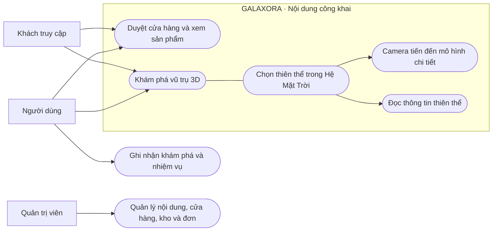
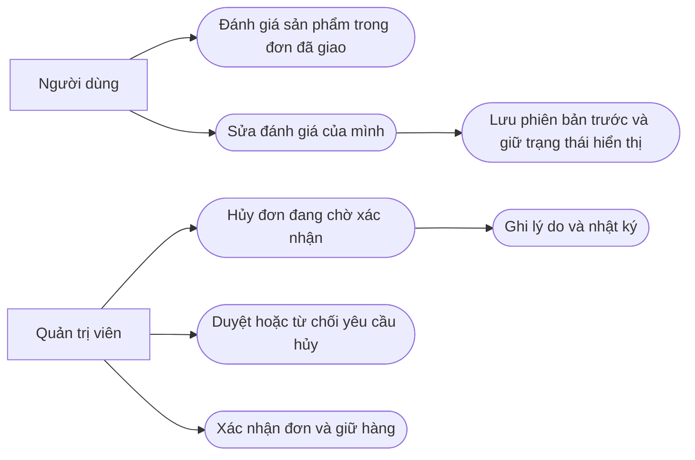

# Sơ đồ use case cập nhật

## Tổng quát và Khám phá 3D

Danh sách chọn của Hệ Mặt Trời gồm Mặt Trời, tám hành tinh, Mặt Trăng và Pluto.

## Cửa hàng và đơn hàng

Sơ đồ cập nhật D1, D2, D13 và D14. Các hình JPG lưu bản use case ban đầu.
